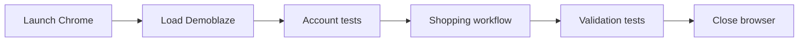

# E-Commerce Automation Testing with Selenium WebDriver


## Overview

A software quality assurance project combining manual functional testing and Python-based browser automation to evaluate [Demoblaze](https://www.demoblaze.com/), a demonstration e-commerce website.

The project investigates critical customer journeys, including account registration, authentication, product selection, shopping cart management and checkout. It also tests invalid inputs and business-rule violations to identify defects rather than simply demonstrate successful browser interactions.

The documented testing campaign covered **18 test cases** and identified **three validation defects**.

## Objectives

- Design test cases with defined inputs, expected results and actual results.
- Automate repeated end-to-end shopping workflows using Selenium WebDriver.
- Handle asynchronous page loading, modal dialogs and JavaScript alerts.
- Evaluate positive, negative, navigation and validation scenarios.
- Document reproducible defects and opportunities for improving software quality.

## Technology Stack

| Technology | Purpose |
|---|---|
| Python 3 | Test scripting |
| Selenium WebDriver | Browser automation |
| Google Chrome | Browser under test |
| Chrome DevTools Protocol (CDP) | Block selected advertising resource URLs |
| WebDriverWait and Expected Conditions | Synchronize browser interactions |
| XPath, ID, link text and class name | Locate UI elements |
| Manual functional testing | Complement automated coverage |

## Project Structure

```text
.
├── automation_testing.py
├── with_pause(1).py
├── Selenium WebDriver Automation Testing Project Report(1).docx
└── README.md
```

| File | Description |
|---|---|
| `automation_testing.py` | Main sequential automation script using explicit waits and short confirmation delays |
| `with_pause(1).py` | Demonstration variant with additional one-second pauses between actions |
| `Selenium WebDriver Automation Testing Project Report(1).docx` | Manual and automated test cases, execution evidence, results and discussion |

## Testing Workflow



The two scripts execute the same general sequence, rather than two independent test suites. Each launches Chrome, configures selected URL blocking, opens Demoblaze, executes eight scenarios in order and waits for Enter before closing the browser.

## Test Results

The following results are taken from the submitted project report, not a new live test run.

| Test method | Total | Passed | Failed | Pass rate |
|---|---:|---:|---:|---:|
| Manual | 10 | 8 | 2 | 80% |
| Automated | 8 | 7 | 1 | 87.5% |
| **Overall** | **18** | **15** | **3** | **83.3%** |

### Manual Test Cases

| ID | Scenario | Expected behavior | Reported result |
|---|---|---|---|
| TC001 | Valid contact form | Success alert | Pass |
| TC002 | Empty contact form | Reject empty submission | Fail |
| TC003 | About us modal | Open and close correctly | Pass |
| TC004 | Product pagination | Navigate next and previous pages | Pass |
| TC005 | Phones category filter | Display phone products | Pass |
| TC006 | Delete cart item | Remove selected product | Pass |
| TC007 | Empty login credentials | Reject login | Pass |
| TC008 | Empty registration credentials | Reject registration | Pass |
| TC009 | Invalid card format | Reject invalid card input | Fail |
| TC010 | Homepage carousel | Navigate between images | Pass |

### Automated Test Cases

| ID | Type | Scenario | Expected behavior | Reported result |
|---|---|---|---|---|
| ATC001 | Positive | Valid registration | Account created | Pass |
| ATC002 | Positive | Valid login | Username displayed | Pass |
| ATC003 | Positive | Add Sony vaio i5 to cart | Product added | Pass |
| ATC004 | Positive | View cart and purchase | Order confirmation | Pass |
| ATC005 | Validation | Checkout without adding another product | Empty-cart order rejected | Fail |
| ATC006 | Navigation | Logout | Login link reappears | Pass |
| ATC007 | Negative | Invalid username | Login rejected | Pass |
| ATC008 | Negative | Existing username | Registration rejected | Pass |

## Defects Identified

| Defect | Test case | Expected result | Observed result in report |
|---|---|---|---|
| Empty contact submission | TC002 | Required fields enforced | Success alert shown for empty fields |
| Invalid card format | TC009 | Invalid card input rejected | Order accepted with `abcd123` |
| Empty-cart checkout | ATC005 | Purchase blocked without products | Purchase confirmation displayed |

These are reported behaviors of the demo application, not failures of Selenium itself. The empty-cart script revisits the cart after a purchase without adding another item; it does not independently assert that the cart is empty before submitting the second order. Adding that check would strengthen the defect evidence.

## Technical Implementation

### Explicit waits

The scripts use a ten-second `WebDriverWait` to synchronize interactions with dynamic UI elements.

```python
wait = WebDriverWait(driver, 10)
wait.until(EC.element_to_be_clickable((By.LINK_TEXT, "Log in")))
```

Conditions include element visibility, clickability, modal invisibility and alert presence. The main script retains two-second delays before purchase confirmation handling; the demonstration variant adds further fixed delays for readability during live demonstrations.

### Scoped element locators

Multiple dialogs contain a Close button. A modal-specific XPath avoids accidentally selecting a button in another dialog.

```python
close_btn = wait.until(
    EC.element_to_be_clickable(
        (By.XPATH, "//div[@id='logInModal']//button[normalize-space()='Close']")
    )
)
close_btn.click()
```

### Alert handling

```python
wait.until(EC.alert_is_present())
alert = driver.switch_to.alert
print("Alert message:", alert.text)
alert.accept()
```

Registration, login rejection and product addition use JavaScript alert handling. Purchase completion is checked by waiting for the visible confirmation heading.

### Browser configuration

Both scripts use Chrome DevTools Protocol commands to enable network inspection and block selected advertising URLs. This is intended to reduce unrelated resource loading during the test run.

## Getting Started

### Requirements

- Python 3
- Google Chrome installed
- Selenium 4 and a compatible ChromeDriver (recent Selenium versions can manage the driver automatically)
- Internet access to the Demoblaze demo website

### Installation

Open a terminal in the project directory:

```bash
python3 -m venv .venv
source .venv/bin/activate
python -m pip install selenium
```

On Windows PowerShell, activate the environment using:

```powershell
.venv\Scripts\Activate.ps1
```

### Configure test accounts before running

The uploaded scripts contain different hardcoded usernames for initial registration and subsequent login. Consequently, a fresh run may depend on an account created previously. For a self-contained run, use the same fresh demo username for the positive registration, positive login and duplicate-registration scenario, with the same dummy password. Keep the invalid-login username separate. Start with an empty cart and use only fictitious customer and card details.

### Execute the tests

Standard execution:

```bash
python automation_testing.py
```

Slower, demonstration-friendly execution:

```bash
python "with_pause(1).py"
```

Chrome opens visibly and performs the scenarios. Alert messages and progress are printed to the terminal. Press Enter when prompted to close the browser. A timeout or unexpected browser state can interrupt the sequential run.

## Current Limitations

- The scripts are sequential procedural demonstrations, not independent pytest or unittest test cases.
- Alert text is printed but not consistently asserted against expected messages.
- The empty-cart scenario explicitly waits for the reported defective success behavior; if the site fixes the issue, the script needs updating to assert the correct rejection instead.
- The scripts do not generate structured pass/fail reports, automatic screenshots or CI results.
- Shared account and cart state can affect repeatability; cleanup is not guaranteed on exceptions.
- Results depend on a third-party demo website and may change over time.
- The reported results are historical observations, not evidence that the current site still has these defects.

## Future Improvements

- Refactor the scenarios into independent pytest tests with fixtures and guaranteed browser teardown.
- Introduce a Page Object Model to separate UI locators from test logic.
- Generate unique test accounts and explicitly reset or verify cart state.
- Add assertions for exact alert messages, cart contents and checkout rejection.
- Replace remaining fixed delays with condition-based waits.
- Capture screenshots on failure and generate HTML or JUnit reports.
- Add headless execution and CI integration against an appropriate controlled test environment.
- Extend automated coverage to the contact form, cart deletion, pagination and invalid card input.

## Project Takeaways

This project demonstrates practical software testing through test-case design, browser automation, UI synchronization, defect documentation and comparison of expected and actual behavior. Combining manual exploration with automated regression scenarios provides broader coverage than relying solely on successful customer journeys.

## References

- [Demoblaze — demo website](https://www.demoblaze.com/)
- [Selenium documentation](https://www.selenium.dev/documentation/)
- Included project report, sections 4–8 (test cases, results and troubleshooting).

> Educational testing project. No real customer or payment information is required.
