# Gas Station & Convenience Store Management System

**Relational database management · Dual-counter Point of Sale · Transactional inventory control**

A business management application built with Oracle APEX, SQL and PL/SQL to unify fuel sales and convenience-store operations. The project focuses on relational data modeling, database integrity, server-side checkout logic, concurrency-aware inventory updates and business reporting.

**[Explore the live application](https://oracleapex.com/ords/r/th_a693_sql_s07/gas-station-convenience-store-management-system/dashboard)** · [Database schema and SQL](Gas_Station_Complete_Script.sql) · [APEX application export](Application_Export.sql)

> Hosted academic demo. Availability may change; please browse without modifying shared records. Screenshots below are original application captures from the project report, cropped for readability, not newly captured from the live deployment.

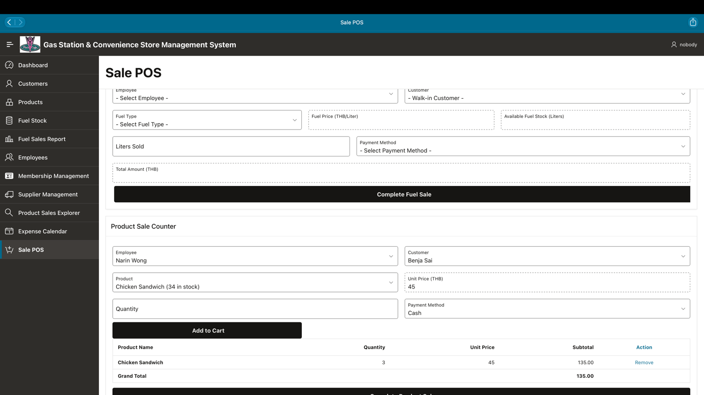

| Database engineering | Application development | Business operations |
| :--- | :--- | :--- |
| **13** relational tables | **15** exported APEX pages | **2** POS counters |
| **16** foreign keys | **20** application processes | Fuel and retail inventory |
| **4** SQL views | Interactive grids and reports | Multi-item orders and analytics |

## 1. Point of Sale System

The POS combines two transaction workflows in one interface. Unlike a simple data-entry form, both counters execute server-side PL/SQL to validate sales, calculate totals using database prices and update inventory.

### Fuel sales counter

- Select an employee, optional customer, fuel tank, quantity and payment method.
- Lock the selected stock row and verify fuel availability.
- Calculate the total from the current database price per liter.
- Deduct fuel quantity using a guarded update and persist the sale in `SALE`.

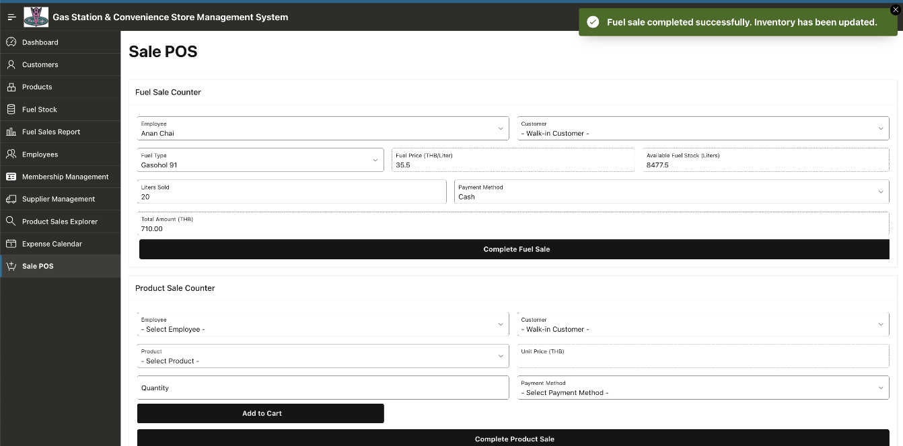

### Convenience-store sales counter

- Add multiple products to a session-scoped `POS_PRODUCT_CART` using `APEX_COLLECTION`.
- Aggregate quantities by product, reject invalid quantities and validate stock and availability again at checkout.
- Lock product rows in product-ID order and calculate the order total using current database prices.
- Create one order header, insert its individual sale lines, deduct inventory and mark depleted items `Out of Stock`.
- Clear the cart after successful checkout.

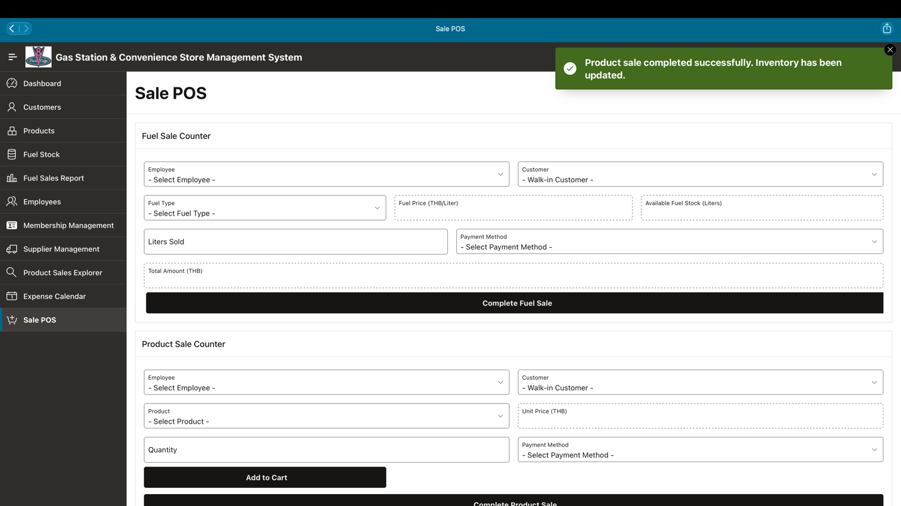

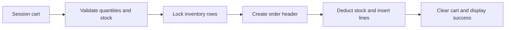

### Why the transaction implementation matters

A stock check performed without a lock can become stale if two cashiers sell the same item concurrently. The exported POS processes use Oracle row-level locking (`SELECT ... FOR UPDATE`) and conditional updates to help prevent this race condition. The following excerpt is adapted from the product checkout process:

```sql
SELECT stock_quantity, selling_price, status
INTO v_stock, v_price, v_status
FROM product_item
WHERE product_id = r.product_id
FOR UPDATE OF stock_quantity;
```

The subsequent inventory update checks that stock remains sufficient and the product is available; `SQL%ROWCOUNT` is checked and an application error is raised if the update fails. Locking products in a consistent order also reduces the risk of deadlocks between checkout sessions. These safeguards are present in the export; concurrent checkout and failure-path rollback have not been independently stress-tested.

## 2. Database Management and Architecture

The database was modeled in MySQL Workbench and implemented in Oracle Database. Oracle APEX provides the application layer; MySQL is not the runtime database.

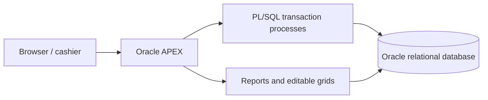

### Entity relationship diagram

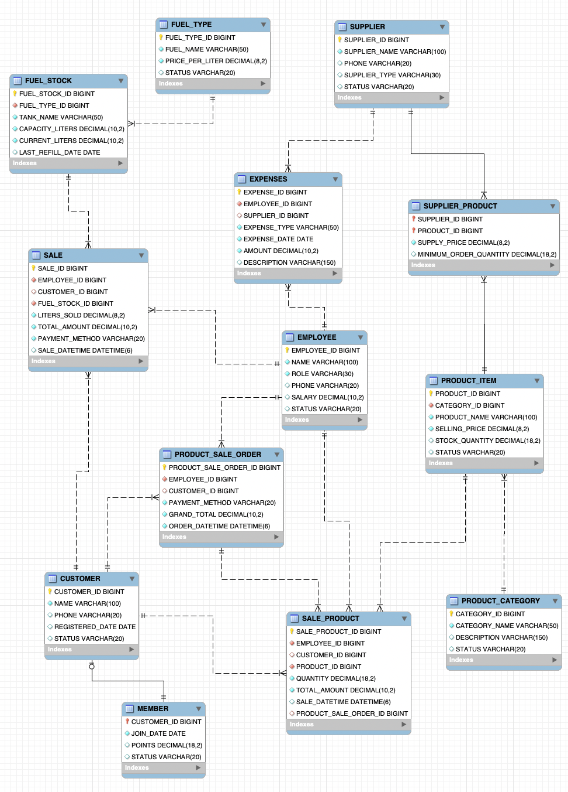

The executable Oracle schema is authoritative for types, nullability and referential actions; the Workbench diagram uses MySQL-style types.

| Domain | Tables | Design purpose |
| --- | --- | --- |
| Fuel operations | `FUEL_TYPE`, `FUEL_STOCK`, `SALE` | Separate fuel pricing, physical tanks and transactions |
| Retail inventory | `PRODUCT_CATEGORY`, `PRODUCT_ITEM` | Product classification, prices and available quantities |
| POS orders | `PRODUCT_SALE_ORDER`, `SALE_PRODUCT` | Order headers and individual product transaction lines |
| Customers | `CUSTOMER`, `MEMBER` | Optional membership and loyalty points |
| Procurement | `SUPPLIER`, `SUPPLIER_PRODUCT` | Many-to-many sourcing relationships and supply terms |
| Administration | `EMPLOYEE`, `EXPENSES` | Staff and operating costs |

### Relational design decisions

- **Order header/detail:** one retail order can contain multiple product lines. Historical standalone sale lines may have no order ID.
- **Composite primary key:** `SUPPLIER_PRODUCT (supplier_id, product_id)` prevents duplicate supplier-product associations while storing supply price and minimum order quantity.
- **Shared primary key:** `MEMBER.customer_id` is both a primary and foreign key, enforcing at most one membership per customer.
- **Optional relationships:** nullable customer IDs support walk-in purchases. Optional supplier IDs support expenses without a supplier.
- **Referential actions:** selected `ON DELETE SET NULL` relationships retain historical sales/expenses; `ON DELETE CASCADE` removes dependent memberships and supplier-product associations.
- **Normalization:** descriptive master data is separated from transactions, with design principles aimed at 3NF. Order-level employee/customer fields are also repeated in sale lines, which warrants further consistency enforcement.

### Inventory management

Editable APEX Interactive Grids provide database-backed maintenance of product stock and fuel tanks.

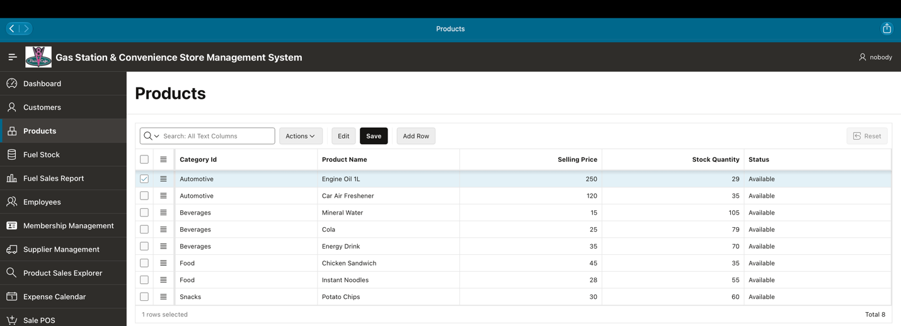

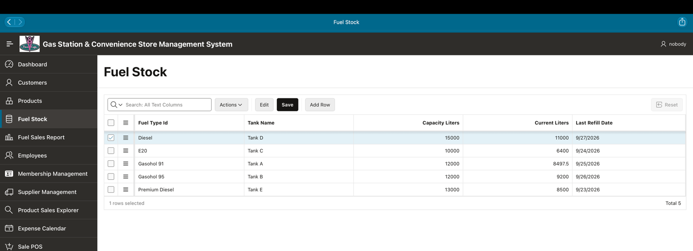

### Data integrity at the database layer

| Constraint | Business rule |
| --- | --- |
| `CHK_STOCK_LEVEL` | Fuel quantity cannot exceed tank capacity |
| `CHK_STOCK_CURRENT` | Fuel stock cannot be negative |
| `CHK_PRODUCT_STOCK` | Product stock cannot be negative |
| `CHK_PRODUCT_PRICE` | Selling price must be positive |
| `CHK_SALE_PAYMENT` | Only Cash, Card or QR payment labels are accepted |
| `CHK_MEMBER_POINTS` | Membership points cannot be negative |
| `UQ_FUEL_NAME`, `UQ_CATEGORY_NAME` | Prevent duplicate fuel and category names |

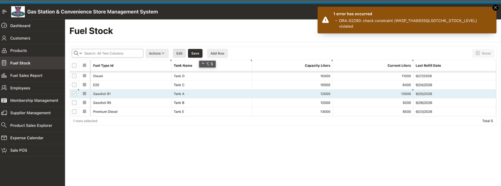

The constraints protect persisted data independently of browser-side validation. The SQL script also includes identity-generated keys, required fields, positive amount checks and foreign-key constraints.

## 3. SQL Analytics and Management Dashboard

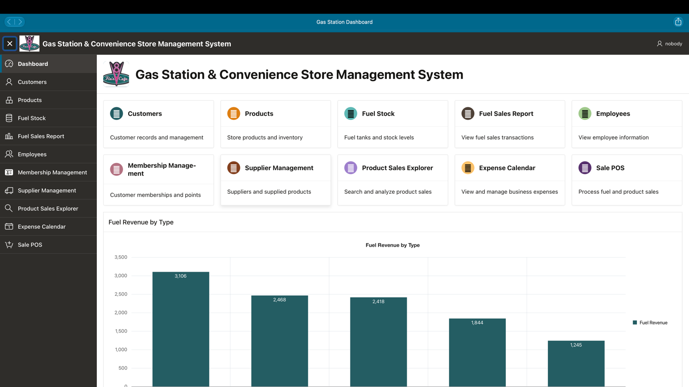

The application combines operational interfaces with reporting. Interactive reports support sales exploration, while the dashboard visualizes fuel revenue and product sales by category.

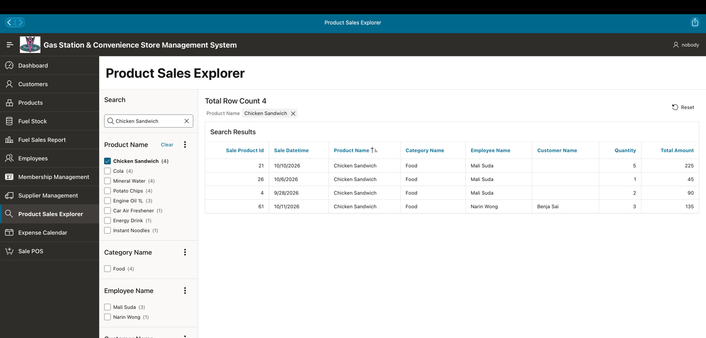

### Database views

| View | Purpose |
| --- | --- |
| `V_FUEL_SALES_DETAILS` | Joins fuel sales, tanks, fuel types, employees and optional customers |
| `V_PRODUCT_SALES_DETAILS` | Detailed retail transactions and product/category information |
| `V_PRODUCT_SALES_SUMMARY` | Aggregated quantity and revenue by product/category |
| `V_TOP_FUEL_SALES` | Five highest-value fuel transactions |

The complete SQL script demonstrates inner/left joins, scalar and correlated subqueries, `EXISTS`, `GROUP BY`, `HAVING`, inline views, `UNION ALL`, `ROLLUP`, `GROUPING()` and top-N queries. It also reconciles receipt headers against their linked sale lines and computes daily revenue without counting both order headers and lines.

Other modules include customer CRUD, employee cards, membership management, supplier management and an expense calendar.

## 4. Testing and Transaction Integrity

The report documents actual application tests, including:

| Scenario | Reported result |
| --- | --- |
| Fuel sale: 20 L × THB 35.50 | THB 710 sale recorded and stock updated |
| Retail sale: 3 sandwiches × THB 45 | THB 135 sale recorded and stock updated |
| Tank quantity exceeds capacity | Rejected by database constraint |
| Customer create, update, delete | Successful |
| DML and transaction demonstration | 14 successful statements, 0 errors |

The final SQL submission includes four expected-failure tests: negative product price, invalid payment method, nonexistent category foreign key and duplicate fuel name. It checks Oracle error codes rather than treating every exception as a successful test. Separate PL/SQL demonstrations use `SAVEPOINT`, `COMMIT` and `ROLLBACK` to illustrate transaction control. These scripts were inspected, not independently executed for this README.

## 5. Technology Stack

| Technology | Role |
| --- | --- |
| Oracle Database | Relational persistence and integrity |
| SQL | DDL, DML, views and analytical queries |
| PL/SQL | Server-side POS logic and validation |
| Oracle APEX | UI, page processes, session state, collections and reporting |
| MySQL Workbench | ERD modeling |

Application export: APEX 26.2.0, compatibility mode 26.1, original application ID 30405.

## 6. Installation

1. Prepare an empty Oracle schema in an APEX environment compatible with the 26.2 export.
2. Upload `Gas_Station_Complete_Script.sql` to SQL Workshop → SQL Scripts. Review section 16 and disable unnecessary public grants before execution. Seed IDs assume a fresh schema; the script contains commit/rollback demonstrations, so avoid unrelated pending work.
3. Verify the 13 tables, 16 foreign keys, four views, seed records and constraint test output.
4. Import `Application_Export.sql` through App Builder, select the target parsing schema and use an unused application ID. Back up existing applications; the export can replace an application with the same ID. Avoid recreating the schema through supporting objects if already installed.
5. Configure authentication, page/process authorization and APEX ACL roles. Run with disposable sample data and verify POS and inventory behavior.

## 7. Current Limitations and Future Improvements

- The academic deployment is not a production security configuration. Manager authorization schemes exist but protection of every write path must be verified; the hosted workspace restricts database role creation. Remove unnecessary public grants and enforce least privilege.
- Payment methods are recorded as labels; no payment gateway or fuel-dispenser hardware integration is implemented.
- Historical fuel reports join the current fuel price. Store the sale-time unit price for accurate historical reporting after price changes.
- Add automated concurrency, rollback and receipt-reconciliation tests, inventory movement history, audit logs and multi-station support.
- Strengthen consistency between order headers and line-level employee/customer references.

## Repository Files

| File | Description |
| --- | --- |
| `Gas_Station_Complete_Script.sql` | Schema, sample data, queries, views and transaction tests |
| `Application_Export.sql` | Oracle APEX application export |
| `GasStation&ConvenienceStore_ERD.mwb` | Editable conceptual data model |
| `GasStation&ConvenienceStore_ERD.png` | Original ERD |
| `FinalReportDB.docx` | Full academic report |
| `assets/` | Application screenshots and ERD embedded in this README |

## Contributors

Sai Lin Phyo · Lin Thant Kyaw

Database Management Systems II — Stamford International University, October 2026.

Before publishing the original files, review student identifiers, contact information, workspace metadata and application security settings. Screenshots reflect the academic sample-data state and are not live operational measurements.
