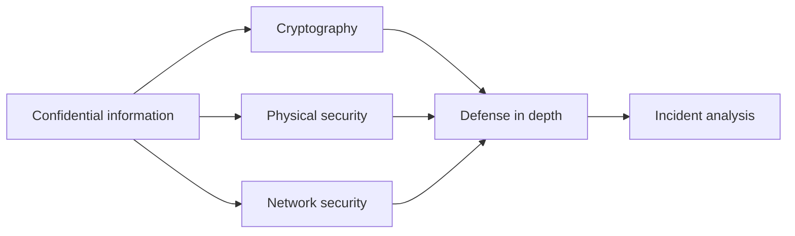
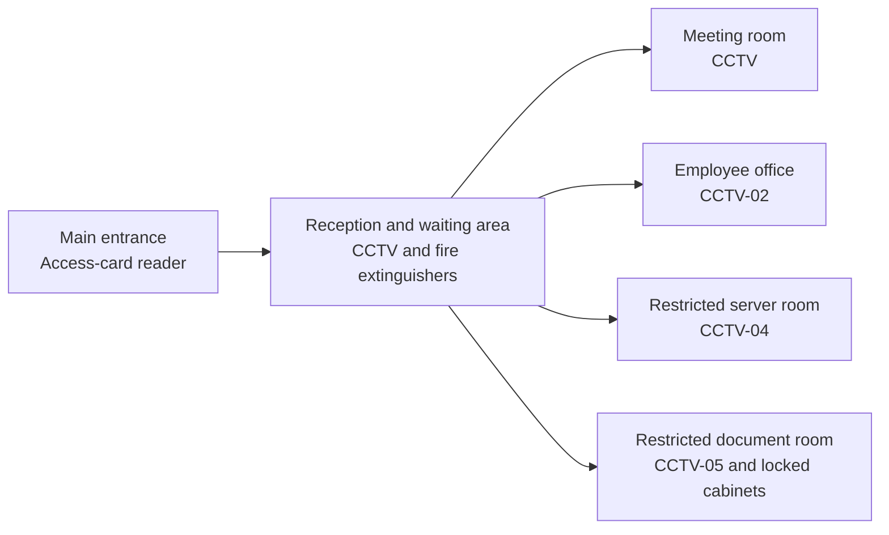
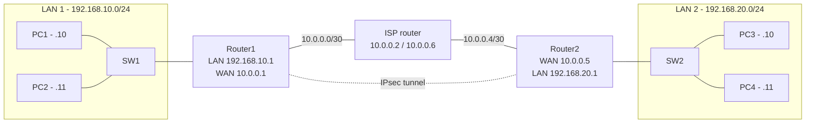

# Information Assurance and Security — Layered Security Design

  

An academic cybersecurity project combining classical cryptography, physical security design, site-to-site VPN configuration, and security incident analysis. The project explores defense in depth through complementary controls designed to protect the confidentiality, integrity, and availability (CIA) of company information.

Developed for **ITE420 — Information Assurance and Security (Section 2)** at Stamford International University.

## Project overview

| Part | Scope | Deliverable |
| --- | --- | --- |
| 1 | Cryptography | Encryption, decryption and comparison of four classical ciphers |
| 2 | Physical security | Office floor plan and risk-based security control selection |
| 3 | Network security | Two-site Cisco Packet Tracer network with static routing and IPsec VPN configuration |
| 4 | Incident analysis | Evaluation of layered controls against unauthorized access |



## 1. Cryptography

The project encrypts and decrypts the message `MEETING AT OFFICE` using four classical algorithms. Spaces are removed for the calculations, producing the 15-letter plaintext `MEETINGATOFFICE`.

| Algorithm | Key | Ciphertext |
| --- | --- | --- |
| Atbash | None | `NVVGRMTZGLUURXV` |
| Vigenère | `SECURE` | `EIGNZRYEVIWJAGG` |
| Rail Fence | 3 rails | `MITIETNAOFCEGFE` |
| Vernam (modulo-26 variant) | `QJXKPVZMWRHTSFD` | `CNBDXIFMPFMYAHH` |

All four examples recover the original normalized plaintext through their corresponding decryption procedures.

### Algorithm mechanics

- **Atbash:** reverses the alphabet; encryption and decryption use the same substitution.
- **Vigenère:** applies shifts determined by a repeating keyword.
- **Rail Fence:** rearranges characters using a zigzag pattern without changing the letters.
- **Vernam:** combines plaintext with a message-length key; this project uses alphabet indices and modulo-26 arithmetic rather than binary XOR.

With `A = 0, ..., Z = 25`:

```text
Atbash:    C = 25 - P
Vigenère:  C = (P + K) mod 26   (repeated keyword)
Vernam:    C = (P + K) mod 26   (message-length key)
Decryption for additive ciphers: P = (C - K) mod 26
```

Three-rail transposition example (dots represent empty positions):

```text
M . . . I . . . T . . . I . .
. E . T . N . A . O . F . C .
. . E . . . G . . . F . . . E
```

The report selects Vernam as the strongest of the four **provided** its key is uniformly random, independent, secret, as long as the message, and never reused. The published sample key is for demonstration only; its randomness is not established. A one-time pad provides confidentiality under these conditions, not authentication or integrity. These classical ciphers are educational examples, not recommended production encryption.

## 2. Physical security

The office design applies access restrictions, monitoring, protected document storage and fire response measures. The following diagram summarizes the proposed zones and controls; the actual floor plan appears in the report (page 7).



| Location | Proposed control | Risk addressed |
| --- | --- | --- |
| Main entrance | Access-card reader | Unauthorized entry |
| Server room | Restricted door, CCTV-04 | Equipment access and tampering |
| Document/storage room | Restricted access, CCTV-05, locked cabinets | Document theft and unauthorized viewing |
| Employee office | CCTV-02 | Suspicious activity |
| Meeting room and reception | CCTV | Monitoring and investigation |
| Reception and storage vicinity | Fire extinguishers | Fire-related damage and disruption |

These are design proposals rather than evidence of a deployed physical security system.

## 3. Network security

The simulated network connects two company LANs through an ISP router. It uses three Cisco 2911 routers, two switches and four PCs. The site-to-site IPsec design protects selected traffic between the two LANs.

### Network topology



The WAN addresses are private lab addresses, not public Internet addresses. The dashed link represents a logical tunnel across the ISP, not a separate physical cable.

### IP addressing

| Device | Interface | Address / prefix | Host gateway |
| --- | --- | --- | --- |
| PC1 | Fa0 | 192.168.10.10/24 | 192.168.10.1 |
| PC2 | Fa0 | 192.168.10.11/24 | 192.168.10.1 |
| Router1 | Gi0/0 | 192.168.10.1/24 | — |
| Router1 | Gi0/1 | 10.0.0.1/30 | — |
| ISP | Gi0/0 | 10.0.0.2/30 | — |
| ISP | Gi0/1 | 10.0.0.6/30 | — |
| Router2 | Gi0/0 | 10.0.0.5/30 | — |
| Router2 | Gi0/1 | 192.168.20.1/24 | — |
| PC3 | Fa0 | 192.168.20.10/24 | 192.168.20.1 |
| PC4 | Fa0 | 192.168.20.11/24 | 192.168.20.1 |

The report's addressing table labels the 10.0.0.1 interface as Router2; its topology, routing and VPN configuration identify it as Router1. The table above follows that documented configuration.

### Static routing

| Router | Destination | Next hop |
| --- | --- | --- |
| Router1 | 0.0.0.0/0 | 10.0.0.2 |
| ISP | 192.168.10.0/24 | 10.0.0.1 |
| ISP | 192.168.20.0/24 | 10.0.0.5 |
| Router2 | 0.0.0.0/0 | 10.0.0.6 |

### Site-to-site VPN configuration

| Parameter | Documented setting |
| --- | --- |
| VPN endpoints | 10.0.0.1 and 10.0.0.5 |
| Protected networks | 192.168.10.0/24 and 192.168.20.0/24 |
| IKE configuration | ISAKMP policy 10 (IKEv1) |
| Encryption | AES |
| Authentication | Pre-shared key |
| Diffie-Hellman group | 2 |
| IPsec transform set | `VPN-SET esp-aes esp-sha-hmac` |
| Traffic selector | Extended ACL 110, mirrored on both routers |
| Crypto map | `VPN-MAP`, sequence 10 |
| WAN interfaces | Router1 Gi0/1; Router2 Gi0/0 |

ACL 110 identifies LAN-to-LAN traffic for encryption; the crypto map binds the peer, transform set and traffic selector to each WAN interface. The complete commands appear in the report (pages 9–11).

### Connectivity results

The report's page 12 screenshots show the following ICMP tests:

| Source | Destination | Sent / received | Loss |
| --- | --- | --- | --- |
| PC1 | PC2 | 4 / 4 | 0% |
| PC1 | PC3 | 4 / 4 | 0% |
| PC3 | PC1 | 4 / 4 | 0% |
| PC3 | PC4 | 4 / 4 | 0% |

These results demonstrate intra-site and inter-site reachability. Successful pings alone do not prove that IPsec encryption was active. To validate the tunnel, generate cross-site traffic and inspect the security associations and packet counters on both edge routers:

```text
show ip route
show crypto isakmp sa
show crypto ipsec sa
show crypto map
```

Check that IKE establishes a security association and that IPsec encapsulation/decryption counters increase. These additional checks are recommended verification steps, not results recorded in the supplied report.

## 4. Security incident analysis

Scenario: an unauthorized person attempts to access confidential company information.

| Layer | Contribution |
| --- | --- |
| Physical | Access cards, restricted rooms and locked cabinets reduce unauthorized physical access. CCTV supports detection and investigation. |
| Network | IPsec is designed to protect selected inter-site traffic against interception. |
| Cryptography | Message encryption protects plaintext confidentiality when appropriate keys and algorithms are used. |
| Defense in depth | Overlapping controls reduce dependence on any single security mechanism. |

The incident is a hypothetical analysis, not a reported real-world attack. VPN protection does not prevent an authorized or compromised endpoint from reading plaintext, and CCTV does not guarantee prevention.

## Repository structure

```text
.
├── README.md
├── part3_FinalProject_420.pkt
├── CybersecurityProject_ITE420.docx
└── ITE420_Cybersecurity_Project_Presentation.pptx
```

## How to explore the project

1. Install Cisco Packet Tracer (a version compatible with the supplied `.pkt` file).
2. Open `part3_FinalProject_420.pkt` in Packet Tracer.
3. Inspect the topology, interface settings, routing and VPN configuration in the router CLI.
4. Run the documented PC connectivity tests and the suggested security-association checks above.
5. Read the report for the cipher calculation tables, original floor plan and incident analysis; use the presentation for a concise overview.

No application build or programming dependencies are required. The Packet Tracer binary was not executed during README preparation; configuration and test results are drawn from the accompanying report and presentation.

## Limitations and future improvements

- Replace the lab's weak pre-shared key, IKEv1, DH group 2 and SHA-1-based IPsec integrity with modern, supported VPN settings for any production deployment.
- Verify encrypted packet counters and capture evidence of protected traffic, not only successful ICMP connectivity.
- Add network segmentation, firewall policy, endpoint protection and centralized monitoring.
- Extend the incident analysis into a response plan with containment, recovery and evidence handling.
- Use modern authenticated encryption for practical data protection instead of classical ciphers.

## Contributors

- Myo Htet Aung
- Lin Thant Kyaw
- KL Ye Myint

Group project — ITE420, Section 2.

## Documentation

- [Full project report](./CybersecurityProject_ITE420.docx)
- [Project presentation](./ITE420_Cybersecurity_Project_Presentation.pptx)
- [Cisco Packet Tracer simulation](./part3_FinalProject_420.pkt)

> Educational security lab. Review the files for personal information and demonstration credentials before publishing; do not reuse lab credentials or legacy VPN settings in production.
