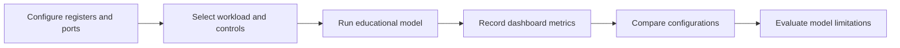

# Register File Architecture & Performance Analysis

 

An experimental study of register-file bandwidth, pipeline hazards, forwarding, workload characteristics and modeled power efficiency in a scientific-computing scenario.

**[Launch the Project 9 Register File Simulator](https://surekhalanka.github.io/Computer-Organization-Projects/Project%209/index.html)**

Computer Organization (BSC/ITE 104) · Stamford International University · October 2026

## Overview

This project investigates how register-file resources interact with workload demand. Five experiments compare read and write port configurations, hardware forwarding, five workload profiles and power-throughput trade-offs. The work also evaluates the limitations of the supplied browser-based simulator rather than treating its outputs as physical CPU measurements.

The simulator is a course-provided tool credited to Surekha Lanka; the student contribution is experimental design, data collection, comparative analysis and model critique.

## Experimental workflow



## Simulator configuration

| Parameter | Available options | Baseline |
|---|---|---|
| 64-bit registers | 128, 256, 512 | 256 |
| Read ports | 2, 3, 4, 6 | 4 |
| Write ports | 1, 2, 4 | 2 |
| Workload | WL1–WL5 | Experiment-dependent |
| Hardware forwarding | ON/OFF | ON |
| Hazard detection | ON/OFF | ON |
| Register renaming | ON/OFF | OFF |

The dashboard reports bandwidth, utilization, throughput, stall cycles, RAW/WAW/WAR hazard counts, forwarding statistics and estimated power. The supplied source analysis identifies HTML, JavaScript and Chart.js 3.9.1 as its implementation technologies.

## Experiments and results

All experiments use 256 × 64-bit registers. Unless otherwise stated, forwarding and hazard detection are enabled and renaming is disabled. Values below are recorded model outputs, not hardware benchmarks.

### 1. Impact of read ports on vectorization

WL2, nominally 2 write ports; average demand is four reads per cycle.

| Read ports | Read demand/capacity | Throughput (ops/cycle) | Stall rate |
|---:|---:|---:|---:|
| 2 | 200% | 3.92 | 2.0% |
| 4 | 100% | 3.92 | 2.0% |
| 6 | 66.7% | 3.92 | 2.0% |

Four read ports match the average demand. The unchanged throughput, even with insufficient capacity, reveals that port contention is not coupled to execution timing. The report's screenshots appear to show four write ports despite the documented two-port setting; this sweep should be repeated with verified controls.

### 2. Write port contention

WL3, four read ports; average demand is 1.6 writes per cycle.

| Write ports | Write demand/capacity | Throughput (ops/cycle) | Stall rate |
|---:|---:|---:|---:|
| 1 | 160% | 3.80 | 5.0% |
| 2 | 80% | 3.80 | 5.0% |
| 4 | 40% | 3.80 | 5.0% |

Two write ports meet average demand with headroom. The model does not establish whether additional ports reduce real execution stalls.

### 3. Hardware forwarding versus stalling

WL1, 4R + 2W.

| Forwarding | Forwarded hazards | Stalled hazards | Throughput (ops/cycle) | Stall rate |
|---|---:|---:|---:|---:|
| OFF | 0 | 950 | 4.00 | 0% |
| ON | 950 | 0 | 4.00 | 0% |

The modeled stalled-hazard count falls to zero, but actual timing metrics do not change. The experiment illustrates forwarding conceptually; it does not quantify an execution speedup.


### 4. Workload comparison

Baseline: 4R + 2W, forwarding and hazard detection ON, renaming OFF.

| Workload | Read utilization | Write utilization | Stall rate | Throughput (ops/cycle) |
|---|---:|---:|---:|---:|
| WL1 — Sequential Scalar | 50% | 50% | 0% | 4.00 |
| WL2 — Vectorized Parallel (SIMD) | 100% | 100% | 2.0% | 3.92 |
| WL3 — Mixed Integer + FP | 80% | 80% | 5.0% | 3.80 |
| WL4 — Load-Heavy | 100% | 50% | 26.1% | 2.96 |
| WL5 — Complex Dependencies | 30% | 40% | 50% | 2.00 |

```text
Modeled throughput (ops/cycle)
WL1 Scalar       ████████████████████  4.00
WL2 SIMD         ███████████████████▋  3.92
WL3 Mixed        ███████████████████   3.80
WL4 Load-heavy   ██████████████▊       2.96
WL5 Complex      ██████████            2.00
```

The predefined profiles illustrate how memory-related delays and dependency chains can limit throughput even when register-file resources are not fully utilized.

### 5. Power versus throughput

WL2, forwarding and hazard detection ON. Renaming settings are reproduced from the report.

| Config | Ports | Rename | Read demand/capacity | Write demand/capacity | Throughput | Reported power | Throughput/power |
|---|---|---|---:|---:|---:|---:|---:|
| A | 4R + 2W | ON | 100% | 100% | 3.92 | 2.29 W | 1.71 |
| B | 6R + 2W | ON | 66.7% | 100% | 3.92 | 2.29 W | 1.71 |
| C | 4R + 4W | OFF | 100% | 50% | 3.92 | 2.29 W | 1.71 |
| D | 6R + 4W | ON | 66.7% | 50% | 3.92 | 2.29 W | 1.71 |
| E | 2R + 1W | ON | 200% | 200% | 3.92 | 2.29 W | 1.71 |
| F | 8R + 2W | — | — | — | N/A | N/A | N/A |

Throughput/power is expressed in ops/cycle/W. Configuration F is unavailable in the simulator. A–E report identical power and throughput, but the model does not enforce resource constraints or account for physical port costs. Renaming differs in configuration C, and the reported power values do not exactly match all values derived from the supplied model equations. The comparison is therefore descriptive, not a controlled physical power study.

## Simulator limitations and model validation
### Scope and fidelity

Project 9 is a browser-based, parameterized educational model, not a cycle-accurate processor simulator. According to the supplied source-code analysis, JavaScript selects predefined workload statistics and calculates dashboard metrics; Chart.js 3.9.1 renders the charts. It does not execute instruction streams, maintain an actual register array, schedule instructions, or simulate a pipeline cycle by cycle. The live simulator URL was supplied with the project, but its current source could not be independently retrieved during preparation of this documentation. The following implementation details therefore describe the supplied analysis and recorded experiments, not a newly verified live build.

### 1. Performance model and cycle accounting

The documented model assumes an ideal execution width of four operations per cycle:

```text
Ideal cycles  = ceil(total operations / 4)
Actual cycles = ideal cycles + predefined stall cycles
Throughput    = total operations / actual cycles
Stall rate    = stall cycles / actual cycles × 100
```

Although a nominal 1,000-cycle constant is used for some counters, it is not the denominator of the displayed throughput. For example, the scalar workload yields 1,000 / 250 = 4.00 ops/cycle, not 1.00 ops/cycle. The complex workload yields 800 / 400 = 2.00 ops/cycle and 200 / 400 = 50% stalls, rather than 0.8 ops/cycle and 20% stalls under a fixed 1,000-cycle interpretation.

Consequently, these values characterize the model's assumptions rather than measured instruction execution or actual scalar/SIMD hardware performance.

### 2. Port contention and bandwidth

Port utilization is calculated as average requested accesses divided by configured ports. Values above 100% indicate demand exceeding nominal capacity, not physically achieved utilization. For example, four requested reads with two read ports produce 200% demand/capacity. The model does not queue excess requests or increase execution cycles in response to contention. Experiment 1 consequently reports 3.92 ops/cycle for 2, 4 and 6 read ports; Experiment 2 reports 3.80 ops/cycle for 1, 2 and 4 write ports.

Bandwidth uses average requested accesses × 8 bytes × 3 GHz, without enforcing configured port capacity. The SIMD workload therefore reports 96 GB/s read and 48 GB/s write demand even when the selected ports cannot sustain it. Read and write conflict counters are fixed at 20 and 10 respectively (2% and 1% of the nominal 1,000 cycles), rather than measured conflicts. The utilization chart is reportedly capped at 100%, potentially concealing overload. Numeric demand ratios should therefore take precedence over the chart.

### 3. Hazard controls and execution timing

- **Forwarding:** Changes forwarded and stalled-hazard counters, but does not update the predefined stall cycles or throughput. In Experiment 3, 950 stalled hazards become 950 forwarded hazards while throughput remains 4.00 ops/cycle and displayed stall rate remains 0%. This is a change in hazard classification, not a measured execution speedup. Percentage reduction in the displayed stall rate is undefined because its original value is zero.
- **Hazard detection:** The supplied analysis reports that the checkbox is not read by `runSimulation()`. Its displayed latency is hard-coded. The interface therefore does not establish functional hazard detection or correctness.
- **Register renaming:** The model reduces WAW counts using `floor(WAW × 0.3)` without changing timing or modeling physical register allocation, WAR elimination or retirement. For mixed workloads, 80 WAW hazards become 24. This is a synthetic reduction rather than a demonstrated renaming implementation.
- **Forwarding coverage:** The dashboard divides forwarded hazards by total RAW + WAW + WAR hazards, not RAW hazards alone. For the documented SIMD profile with renaming off, 90 / 150 = 60%, versus 90 / 100 = 90% when considering RAW alone. The label “accuracy” should not be interpreted as correctness of forwarded values.

### 4. Power and energy model

The supplied analysis documents these heuristic equations (watts):

```text
Register-file dynamic power = 0.5 + 0.2 × (average reads + average writes)
Hazard logic power          = 0.3 + 0.5 × total hazards / 1000
Leakage power               = 0.2 + 0.1 × register count / 1000
Total power                 = sum of the three components
```

Physical port count does not directly enter these equations. Register count affects modeled leakage only, not execution timing, capacity pressure or register allocation. The model does not account for port-dependent area, wiring, capacitance, timing or technology characteristics. Identical power readings across configurations do not demonstrate equal real hardware power.

The dashboard's `Ops/W` divides total operations by power, rather than an operation rate by power. Its reported power-per-operation and energy metrics likewise lack an explicit execution-time term. For physical energy estimates, use `time = cycles / clock frequency`, `energy = average power × time`, and `energy per operation = energy / operations`, provided power and timing are valid measurements or estimates. The report's throughput/power metric (ops/cycle/W) is a comparative model score, not physical ops/J.

### 5. Experimental scope and consistency

The maximum selectable read-port count is six, so the proposed 8R + 2W configuration was not tested. Experiment 5 also varies renaming: A, B, D and E are documented as ON, C as OFF. This is a confounding variable. The report records 2.29 W for A–E, but the supplied equations predict approximately 2.30 W for the renaming-off SIMD case (2.3006 W), versus 2.2831 W with renaming enabled, using the documented fixed hazard profile. These values do not reproduce every displayed value exactly; retain the recorded observations and treat the difference as a model/version or configuration discrepancy requiring verification. The report's figure on page 25 includes an F point, but its table on page 20 explicitly marks F N/A; the table is used for the experimental summary.

The Experiment 1 screenshots on report pages 3–5 also appear to show four write ports despite the documented 2W setting. The unchanged throughput is recorded, but the screenshots do not establish a fully controlled read-port sweep. Re-run the experiment with recorded settings before claiming isolated causal effects.

### Interpretation and future work

The simulator is useful for explaining demand/capacity ratios, comparing predefined workload profiles and illustrating hazard concepts. It cannot establish real processor speedup, actual conflict rates, hardware correctness, silicon area or energy efficiency. A stronger study would use a cycle-based scheduler with finite ports, instruction dependencies and forwarding latency; couple stalls to resource conflicts; validate renaming and hazard detection; expose reproducible configuration logs; and compare timing and power against a calibrated architecture simulator or RTL implementation. A controlled factorial design should hold all non-tested variables constant.

## Conclusion

For the tested SIMD profile, 4R + 2W matches average read/write demand and the model reports 3.92 ops/cycle, approximately 2% stalls and 2.29 W (below the coursework's 5 W target). This is a reasonable educational design recommendation, not proof of an optimal physical register file. Real designs require workload-sensitive scheduling, correct hazard handling, and validated area, timing and energy models.

## Reproduce the experiments

1. Open the linked simulator in a browser.
2. Select 256 registers and the experiment's workload and port configuration.
3. Set forwarding, hazard detection and renaming as documented above.
4. Run Simulation and record the numeric dashboard outputs; capture the selected controls together with each result.
5. Change only the independent variable for each sweep, and compare the results with the tables above.

The current live simulator could not be independently fetched during documentation preparation; the supplied report, screenshots and source-analysis document are the basis of this README. No local simulator source or execution engine is included in the provided materials.

## Project materials

- [Final_Project_9.docx](./Final_Project_9.docx) — original experimental report, including screenshots and analysis.
- [Simulator limitation.docx](./Simulator%20limitation.docx) — original model implementation analysis.
- Experiment screenshots (`Experiment1_*.png` through `Experiment5_*.png`) — 18 supplied captures documenting the five experimental groups. The report contains the visual evidence, so this README does not depend on external image assets.

## Credits

- Pham Duc Dat
- Lin Thant Kyaw

Course instructor and simulator provider: Surekha Lanka.

## References

- [Project 9 Register File Simulator](https://surekhalanka.github.io/Computer-Organization-Projects/Project%209/index.html)
- Balasubramonian, Dwarkadas & Albonesi, *Reducing the Complexity of the Register File in Dynamic Superscalar Processors*, MICRO, 2001 (as cited in the project report).
- Horowitz, *Computing’s Energy Problem (and What We Can Do About It)*, ISSCC, 2014 (as cited in the project report).
- See the original report for the complete bibliography.
