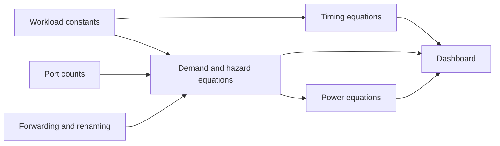
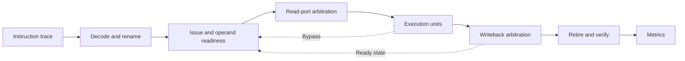

# Register File Simulator — Technical Model Audit

> Computer Organization (BSC/ITE 104), Project 9 | Companion analysis to the experimental report

[Open the educational simulator](https://surekhalanka.github.io/Computer-Organization-Projects/Project%209/index.html)

## 1. Scope and evidence

This investigation examines whether the simulator's reported throughput, utilization, hazards and power respond consistently to architectural configuration changes. The evidence consists of `Simulator limitation.docx` (13 pages, sections 27–53), `Final_Project_9.docx` (32 pages), and the 18 supplied experiment screenshots. JavaScript expressions below are reconstructed from the supplied implementation analysis; the current hosted source could not be independently retrieved. This is a model audit, not a new execution benchmark or a claim that the project team authored the simulator. Proposed remedies are architectural design suggestions, not implemented features.

## 2. Fundamental limitation: a parameterized model rather than execution simulation

The supplied analysis describes a browser application using HTML, JavaScript and Chart.js 3.9.1. Workload selection supplies predetermined operation counts, average operand demand, stall cycles and hazard counts. Configuration controls modify selected arithmetic outputs, rather than driving an instruction execution engine.



The important missing feedback is from resource conflicts and dependency resolution to execution timing. No instruction trace, register-value state, ready-operand scoreboard, issue queue, writeback arbitration or per-cycle pipeline state is described. Therefore the dashboard can illustrate relationships encoded by its equations but cannot discover new timing behavior arising from architectural interactions.

### Workload constants

| Workload | Operations | Average reads | Average writes | Assigned stall cycles | RAW | WAW | WAR | Forwarded with forwarding ON |
|---|---:|---:|---:|---:|---:|---:|---:|---:|
| WL1 Scalar | 1000 | 2 | 1 | 0 | 950 | 0 | 0 | 950 |
| WL2 SIMD | 4000 | 4 | 2 | 20 | 100 | 50 | 0 | 90 |
| WL3 Mixed | 3800 | 3.2 | 1.6 | 50 | 180 | 80 | 40 | 150 |
| WL4 Load-heavy | 1700 | 4 | 1 | 150 | 500 | 0 | 300 | 250 |
| WL5 Complex | 800 | 1.2 | 0.8 | 200 | 400 | 100 | 50 | 380 |

Source: limitations document, section 29. These are assigned inputs, not measured events. The screenshots for WL2 sometimes show 115 hazards (100 RAW, 15 WAW), consistent with renaming being enabled rather than the documented rename-OFF baseline. Configuration discrepancies are discussed below.

## 3. Execution timing: incompatible interpretations of cycles

The model retains a nominal `totalCycles = 1000`, but calculates actual execution time separately:

```javascript
// Reconstructed equations, not a verbatim source listing
idealCycles = Math.ceil(totalOps / 4);
actualCycles = idealCycles + stallCycles;
throughput = totalOps / actualCycles;
stallRate = 100 * stallCycles / actualCycles;
```

The divisor of four implicitly assumes an ideal processing rate of four operations per cycle for every workload. It does not follow from the selected read/write ports, instruction mix or actual issue decisions.

| Workload | Ideal cycles | Assigned stalls | Actual cycles | Ops/cycle | Stall rate |
|---|---:|---:|---:|---:|---:|
| Scalar | 250 | 0 | 250 | 4.00 | 0% |
| SIMD | 1000 | 20 | 1020 | 3.9216 | 1.96% |
| Mixed | 950 | 50 | 1000 | 3.80 | 5% |
| Load-heavy | 425 | 150 | 575 | 2.9565 | 26.09% |
| Complex | 200 | 200 | 400 | 2.00 | 50% |

### Scalar versus vectorized interpretation

The assignment narrative described scalar processing as approximately one operation per cycle over 1000 cycles. The implementation instead computes `1000 / 250 = 4`. Likewise the complex workload's nominal 800 operations over 1000 cycles and 200 stalls would imply 0.8 ops/cycle and 20% stalls if the observation window were fixed at 1000 cycles. The dashboard uses 400 actual cycles, giving 2 ops/cycle and 50% stalls. Neither interpretation is interchangeable with the other.

Operations must also be defined consistently: an instruction, micro-operation and SIMD lane operation are different units. A vector instruction may perform several arithmetic operations while requiring fewer register accesses than the number of lane operations. The simulator does not establish a mapping between these units.

### Why the throughput/stall correlation is not independent evidence

For these workloads, `idealCycles = totalOps / 4` exactly. Substituting into the equations yields:

$$T = 4(1-s)$$

where $s$ is the stall fraction (not percentage). Thus 50% stalls necessarily yields 2 ops/cycle, and 5% yields 3.8. The correlation in the report is mathematically imposed by the model; it is not independent empirical evidence that a particular architectural bottleneck caused that decrease.

**Remedy:** define either a fixed observation window or a run-to-completion experiment; specify instruction versus operation counts; derive elapsed cycles from scheduled events and completed instructions. Report IPC and arithmetic operations/cycle separately when SIMD is involved.

## 4. Read and write ports: demand is not service capacity

The utilization equations are:

$$U_R = 100\frac{D_R}{R},\qquad U_W = 100\frac{D_W}{W}$$

where $D$ is predetermined average demand and $R,W$ are configured port counts. These are demand-to-capacity ratios, not observed physical occupancy.

| Experiment | Ports varied | Reported utilization | Throughput | Stall rate |
|---|---|---|---:|---:|
| 1, SIMD | 2R / 4R / 6R | 200% / 100% / 66.7% read | 3.92 | 2% |
| 2, Mixed | 1W / 2W / 4W | 160% / 80% / 40% write | 3.80 | 5% |

### 4.1 What 200% actually means

If each read port can serve one operand per cycle, two ports can serve at most two reads in that cycle. Four requested reads cannot all be physically served without additional mechanisms (multi-pumping, replicated resources, operand reuse or bypassing, for example). The model leaves average reads at four regardless of configured capacity and never schedules outstanding requests. Thus it reports overload without enforcing it.

A simple illustrative service model assumes four independent read requests arrive in one cycle, two single-access ports, no bypasses and no banking restrictions:

| Cycle | New requests | Pending at start after arrivals | Served | Remaining |
|---|---:|---:|---:|---:|
| 1 | 4 | 4 | 2 | 2 |
| 2 | 0 | 2 | 2 | 0 |

The requests require at least two service cycles. This is an example of resource serialization, not a prediction of the actual SIMD workload's IPC. Some reads might overlap with unrelated work; dependency and issue timing determine the real throughput penalty.

### 4.2 A capacity-bound alternative

If each operation requires on average $r$ physical reads and $w$ physical writes, all accesses use the register file, ports serve one access per cycle, and issue capacity is $I$ operations/cycle, then a steady-state upper bound is:

$$T_{max} \le \min(I, R/r, W/w)$$

Omit a term when its demand is zero. For a hypothetical four-operation group needing four reads and two writes, $r=1$, $w=0.5$, and $I=4$. With 2R/1W the upper bound is 2 ops/cycle; with 4R/2W it is 4. This is conditional on the assumed mapping of operations to accesses; the existing workload averages do not establish that mapping, so this must not be presented as a corrected measured benchmark.

Average demand also hides bursts. Two writes per cycle on average can still contend with two write ports if four results complete simultaneously and none complete on the following cycle. A realistic model needs a distribution of requests over time, not just a mean.

### 4.3 Conflict counters are synthetic

The source analysis reports:

```javascript
readConflicts = Math.floor(totalCycles * 0.02); // 20
writeConflicts = Math.floor(totalCycles * 0.01); // 10
```

These indicators are independent of port count, workload and actual elapsed cycles. A configuration with spare capacity can therefore display the same number of conflicts as an overloaded configuration. They cannot establish either structural hazard frequency or the effect of additional ports.

**Remedy:** count denied/deferred access requests when arbitration cannot grant a port, record cycles with at least one conflict separately, and track queue delay. Physical utilization should be `granted accesses / available port-cycles`; demand pressure may exceed 100% but occupancy may not.

## 5. Forwarding: hazard statistics disconnected from timing

Forwarding (bypassing) allows a dependent instruction to consume a completed producer result before normal register-file writeback. It can reduce RAW wait time, but only when a valid bypass path exists and the result is ready.

Example with a conventional five-stage pipeline (IF, ID, EX, MEM, WB), ALU result ready after EX, and no same-cycle WB-to-ID limitation:

```text
Cycle                 1   2   3   4   5   6   7   8
Producer ADD          IF  ID  EX  MEM WB
Dependent, bypass         IF  ID  EX  MEM WB
Dependent, no bypass      IF  ID  ID  ID  EX  MEM WB
```

The exact delay depends on pipeline/register-file timing; loads may still require a stall even with forwarding. The two dependent rows are alternative schedules, not simultaneously executed instructions.

### Experiment 3: observed contradiction

| Forwarding | RAW | Forwarded | Classified stalled hazards | Pipeline stall cycles | Throughput |
|---|---:|---:|---:|---:|---:|
| OFF | 950 | 0 | 950 | 0 | 4.00 |
| ON | 950 | 950 | 0 | 0 | 4.00 |

The forwarding checkbox changes hazard classification but does not recalculate `stallCycles`. The reported 950 stalled hazards are therefore not equivalent to 950 elapsed stall cycles. In a real pipeline, multiple dependencies can overlap or one dependency can cause multiple cycles of waiting; a one-to-one conversion is invalid.

The reduction in the *classified stalled-hazard count* is 100%, but the reduction in pipeline stall rate in percentage points is zero. Relative stall-rate reduction is undefined because its baseline denominator is zero. No speedup can be inferred from this experiment: displayed throughput ratio is 1.0.

**Remedy:** determine operand readiness from producer completion, register writeback and enabled bypass paths. Derive stalls from instructions unable to advance, rather than toggling a fixed counter. Use dependency chain tests with forwarding ON/OFF and compare completion cycles.

## 6. Forwarding coverage: denominator and semantics

The dashboard's forwarding accuracy is reported as:

$$F_{display}=100\frac{N_{forwarded}}{N_{RAW}+N_{WAW}+N_{WAR}}$$

A more specific RAW coverage measure, assuming all counted forwarded events are RAW events from the same population, is:

$$F_{RAW}=100\frac{N_{forwarded,RAW}}{N_{RAW}}$$

| Workload (rename OFF) | Forwarded | RAW | All hazards | Displayed coverage | Implied RAW coverage |
|---|---:|---:|---:|---:|---:|
| Scalar | 950 | 950 | 950 | 100% | 100% |
| SIMD | 90 | 100 | 150 | 60% | 90% |
| Mixed | 150 | 180 | 300 | 50% | 83.3% |
| Load-heavy | 250 | 500 | 800 | 31.25% | 50% |
| Complex | 380 | 400 | 550 | 69.09% | 95% |

WAW and WAR are name dependencies, not RAW producer-consumer relationships that ordinary operand forwarding resolves. Consequently, an all-hazard denominator mixes distinct mechanisms. Neither metric measures prediction accuracy.

Renaming WL2 reduces WAW from 50 to 15, changing total hazards from 150 to 115. With the same 90 forwarded events, the displayed fraction rises from 60% to 78.26%, despite no additional RAW forwarding. This explains the 78.3% shown in several submitted screenshots. RAW coverage remains 90% under the stated assumption.

**Remedy:** separate RAW dependencies, bypass-eligible RAW dependencies, successfully forwarded operands, WAR/WAW events, and elapsed dependency stall cycles. Define denominators and zero-denominator behavior explicitly.

## 7. Hazard detection control: interface without corresponding behavior

According to section 40, `runSimulation()` does not read `hazardDetectEnable`. The checkbox changes no result. The displayed detection latency (`<1 cy`) is fixed text, not measured timing.

In a functional pipeline, hazard detection is necessary to prevent premature operand consumption or conflicting updates unless another mechanism guarantees correctness. Disabling checks may yield incorrect architectural state; a faster but incorrect run is not a valid performance improvement.

**Remedy:** model readiness checks and interlocks; if an unsafe mode is exposed for education, compare final register/memory state with a sequential reference interpreter and clearly mark incorrect results. Detection logic timing should be modeled or explicitly declared a fixed assumption, not a measured value.

## 8. Register renaming: count adjustment versus physical allocation

The documented rule is `WAW = floor(WAW * 0.3)`. Mixed workload WAW falls from 80 to 24; WAR is unchanged, and actual cycles remain 1000. This is a synthetic 70% reduction in selected name-dependency counts.

Real renaming maps architectural registers to physical registers. For example:

```text
I1: R1 = R2 + R3       allocate P10 for new R1
I2: R4 = R1 + R5       read P10
I3: R1 = R6 + R7       allocate P11 for newer R1
```

I2 must continue using P10 even after R1 maps to P11. The independent destinations remove the WAW ordering restriction between I1 and I3 and avoid a WAR conflict with older consumers. The true RAW dependence from I1 to I2 remains.

A real implementation needs a rename map, physical-register free list, allocation/reclamation policy, readiness bits and a safe retirement mechanism. Exhausting the free list may itself stall dispatch. A fixed multiplication cannot represent these interactions or establish correctness.

## 9. Register capacity: storage size without register pressure

The simulator offers 128, 256 and 512 registers of 64 bits. According to section 44, this changes displayed capacity and leakage, not timing, utilization or hazards.

| Registers | Raw data storage | Modeled leakage |
|---:|---:|---:|
| 128 | 1024 bytes | 0.2128 W |
| 256 | 2048 bytes | 0.2256 W |
| 512 | 4096 bytes | 0.2512 W |

These storage sizes exclude tags, ports, decoding and control structures. Physical register pressure affects rename allocation; architectural register pressure can affect compiler spilling to memory. Those are distinct effects and require a defined ISA, trace and allocation model. Larger register files may also increase access delay and area, neither of which is dynamically modeled here.

## 10. Bandwidth: offered traffic versus delivered traffic

The supplied equations assume 64-bit accesses and a 3 GHz clock:

$$B_R=D_R\times8\times3\ \text{GB/s}$$

$$B_W=D_W\times8\times3\ \text{GB/s}$$

| Workload | Read demand GB/s | Write demand GB/s | Total demand GB/s |
|---|---:|---:|---:|
| Scalar | 48 | 24 | 72 |
| SIMD | 96 | 48 | 144 |
| Mixed | 76.8 | 38.4 | 115.2 |
| Load-heavy | 96 | 24 | 120 |
| Complex | 28.8 | 19.2 | 48 |

With two single-access read ports at 3 GHz, peak read service is `2 × 8 × 3 = 48 GB/s`, not 96. Thus the displayed SIMD read bandwidth of 96 GB/s in 2R configuration represents demand, not feasible sustained register-file delivery under those assumptions.

Bandwidth is internal register-file traffic, not DRAM bandwidth. The model does not specify cache hits, misses, load/store queues, memory-level parallelism or effective memory bandwidth, so WL4's assigned stall count cannot independently validate a memory bottleneck.

**Remedy:** report offered, peak theoretical and granted bandwidth separately. Granted bandwidth should be derived from actual transfers divided by elapsed simulation time.

## 11. Power model: arithmetic and sensitivity

The limitations document (sections 45–48) describes these equations:

```text
P_RF      = 0.5 + 0.2 × (average reads + average writes)
P_hazard  = 0.3 + 0.5 × total hazards / 1000
P_leak    = 0.2 + 0.1 × register count / 1000
P_total   = P_RF + P_hazard + P_leak
```

Constants are treated as model coefficients in watts. At 256 registers, leakage is 0.2256 W. For SIMD with renaming OFF:

```text
P_RF      = 0.5 + 0.2 × 6 = 1.7 W
P_hazard  = 0.3 + 0.5 × 150 / 1000 = 0.375 W
P_total   = 1.7 + 0.375 + 0.2256 = 2.3006 W
```

With renaming ON, 115 hazards yield 0.3575 W hazard power and 2.2831 W total before display rounding. The report records 2.29 W in all tested configurations, while its configuration C specifies rename OFF. The documented equations do not yield exactly identical totals across these settings. The limitations document also lists about 2.31 W for the default SIMD case. These should be retained as discrepancies rather than silently reconciled; a controlled rerun with verified settings and original source is needed.

### Reconstructed totals (rename OFF)

| Workload | RF power | Hazard power | Leakage | Total W |
|---|---:|---:|---:|---:|
| Scalar | 1.10 | 0.775 | 0.2256 | 2.1006 |
| SIMD | 1.70 | 0.375 | 0.2256 | 2.3006 |
| Mixed | 1.46 | 0.450 | 0.2256 | 2.1356 |
| Load-heavy | 1.50 | 0.700 | 0.2256 | 2.4256 |
| Complex | 0.90 | 0.575 | 0.2256 | 1.7006 |

The equations do not include the configured physical read/write port count, capacitance, voltage, switching activity per actual access, technology node, temperature or physical layout. Therefore varying port capacity alone cannot change modeled power if the workload and other settings remain fixed. Renaming reduces hazard power arithmetically but adds no modeled map/free-list/control overhead.

In real hardware, additional ports can require more wordlines, bitlines, access devices, multiplexers and bypass wiring. Dynamic power is often approximated as $P_{dyn}=\alpha C V^2 f$ with activity factor, effective switched capacitance, voltage and clock frequency. Leakage depends on device count, technology, voltage and temperature. An actual design trade-off also involves critical-path delay and area; frequency cannot necessarily remain fixed when ports are added.

**Remedy:** use calibrated per-access energy and idle/active leakage parameters that depend on physical configuration; separately account for bypass, arbitration and rename logic. For physically meaningful estimates use a validated register-file circuit/array model or synthesis and characterized technology libraries. Without calibration, report relative hypothetical costs only.

## 12. Energy efficiency: dimensional analysis

Power is joules per second. Energy requires elapsed time. The documented dashboard formulas are `1000 × P / N` (mW/op), `N / P` (ops/W), and `10^9 × P / N` labeled energy per 1000 ops in nJ. These use total operation count, not execution time, so they do not establish physical energy efficiency.

The report's separate `throughput / power` calculation gives 3.92/2.29 ≈ 1.71 ops/cycle/W. That is a valid model comparison index at a common frequency, but not ops/joule until multiplied by clock frequency.

For an illustrative calculation using the recorded SIMD values (4000 operations, 1020 cycles, 2.29 W) and assuming 3 GHz and constant average power over those cycles:

```text
Elapsed time = 1020 / 3e9 = 340 ns
Total energy = 2.29 × 340 ns = 778.6 nJ
Energy/op    = 778.6 / 4000 = 0.19465 nJ/op
Energy/1000 ops = 194.65 nJ
Operations/s = 4000 / 340 ns ≈ 11.765e9
Operations/J ≈ 5.137e9
```

These are dimensionally consistent transformations of hypothetical modeled values, not actual hardware energy measurements. General equations:

$$t=C/f,\quad E=Pt,\quad E_{op}=E/N,\quad \eta=N/E=Tf/P$$

where $C$ is elapsed cycles, $N$ completed operations, and $T$ operations/cycle. If power varies with execution, integrate power over time or sum per-cycle energy.

## 13. Visualization and experiment reproducibility

- The utilization chart is reported to cap its vertical axis at 100%, hiding differences among overloaded configurations. Show demand ratios on an uncapped axis with a 100% reference line, and occupancy separately.
- The hazard distribution doughnut illustrates composition, not ordering, latency or whether hazards overlap.
- The maximum selectable read-port count is six. Experiment 5 configuration F (8R/2W) is unavailable, so it must remain N/A. The report's Figure 4 includes an F point despite the table marking it unavailable; that figure is not valid evidence for an 8R result.
- Experiment 5 changes renaming alongside port counts (C OFF, other tested configurations ON, according to the report). This confounds isolation of port-related power effects.
- Experiment 1 screenshots show differing write-port panel values (including four write ports in screenshots labeled 2W). Several WL2 screenshots show 115 hazards, consistent with renaming ON rather than the stated OFF. The read-utilization and timing values remain useful as displayed observations, but exact settings need verification before controlled comparison.
- A dashboard labeled 'over time' does not demonstrate a time series if it displays only aggregate read/write values.

For reproducibility, export configuration, workload constants, source revision, full-precision results and metric definitions together. Capture configuration controls and outputs in the same screenshot or exported record. Change one independent variable at a time.

## 14. Proposed redesign: a causal, cycle-stepped architectural model



A minimal educational redesign can use deterministic instruction traces with explicit source/destination registers, operation type and latency. Begin with an in-order model, then add out-of-order issue and renaming only when their correctness can be tested. The following is conceptual pseudocode, not code extracted from the supplied simulator:

```text
while instructions remain or pipeline is not empty:
    cycle += 1
    retire eligible completed instructions in program order
    arbitrate writeback requests and update readiness
    advance functional units and mark completed results
    identify operands available via register file or valid bypass
    arbitrate issue and physical read-port requests
    dispatch/rename instructions if resources are available
    accumulate grants, denied requests, stalls and energy
```

Specify stage ordering and whether newly completed results can bypass in the same cycle; otherwise the pseudocode is ambiguous about timing. Enforce bounded queues, port grants and functional unit capacity. Memory instructions need a declared latency model; a fixed latency is an acceptable first step, but should be explicit. Count per-cycle stall reasons without double-counting overlapping causes, and distinguish full-pipeline stalls from unused issue slots.

Suggested regression cases:

| Test | Expected invariant or qualitative response |
|---|---|
| Independent operations with plentiful resources | No operand-dependency stalls; throughput bounded by issue and execution capacity |
| Four reads, two single-access ports | No more than two physical reads granted in any cycle |
| Burst of simultaneous results | Writeback grants never exceed configured ports; others wait |
| Dependent ALU chain | Forwarding changes operand-ready time when bypass is useful |
| Load-use chain | Consumer waits until load value is available, even with forwarding |
| WAR/WAW sequence | Correct renaming removes false dependencies without changing final result |
| Free-list exhaustion | Rename dispatch stalls until a physical register becomes free |
| All workloads | Final architectural state matches reference interpreter |
| Metric consistency | Completed ops / elapsed cycles equals reported throughput; energy units are consistent |

These tests are proposed, not executed results. A trace-driven or cycle-stepped model would still be an abstraction, not a guarantee of silicon accuracy. Validate its assumptions against a reference simulator or hardware measurements before quantitative architectural claims.

## 15. What the experiments actually establish

The submitted study supports the conclusion that 4R/2W matches the *assigned average* SIMD operand demand and that the dashboard illustrates different synthetic workload profiles. It also establishes that the current educational model is insensitive to important changes that would normally affect timing or power in a real architecture.

It does **not** establish that 4R/2W maximizes physical power efficiency, that forwarding produces a measured speedup, that register renaming improves IPC, or that memory latency was independently measured. Identical outputs across configurations are evidence of limited model sensitivity, not proof that the corresponding hardware configurations perform identically.

The central finding is therefore a model-validity issue: utilization, hazard classification, timing and power are partially independent calculations. Connecting these quantities through an explicit instruction execution and resource arbitration model is the essential next step.

## References and source traceability

- `Simulator limitation.docx`, sections 27–53: documented controls, workload constants and equations.
- `Final_Project_9.docx`, pp. 19–20: recorded experiment tables; pp. 25–28: interpretation and limitations; p. 32: bibliography.
- Submitted experiment screenshots: Experiments 1–5, 18 images.
- [Project 9 simulator](https://surekhalanka.github.io/Computer-Organization-Projects/Project%209/index.html) — hosted reference; current source not independently verified for this audit.
- Background references listed in the project report: [Balasubramonian et al., Reducing the Complexity of the Register File in Dynamic Superscalar Processors](https://www.csl.cornell.edu/~albonesi/research/papers/micro01.pdf); [Horowitz, Computing's Energy Problem](https://doi.org/10.1109/ISSCC.2014.6757323); [Monreal et al., Dynamic Register Renaming through Virtual-Physical Registers](https://www.jilp.org/vol2/v2paper10.pdf). These are background pointers inherited from the report, not independently reviewed sources in this audit.
