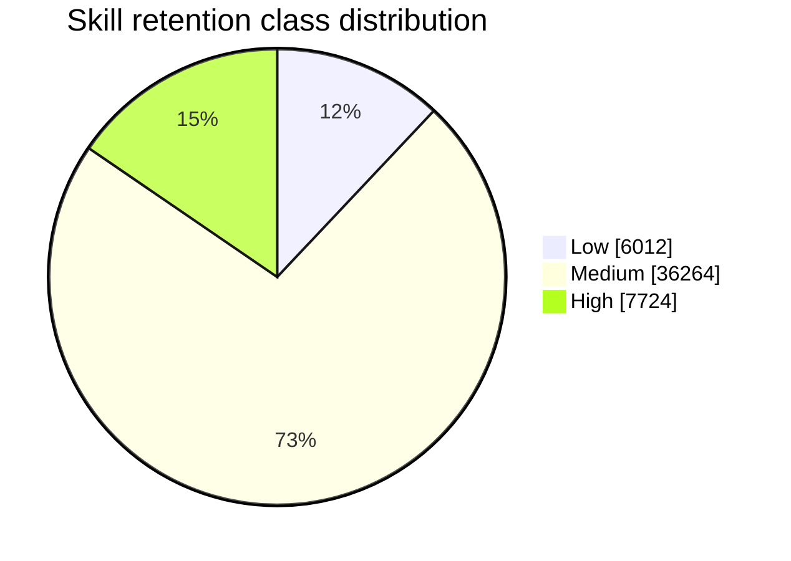
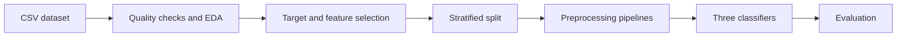

# Student Skill Retention Prediction

**Machine Learning Analysis of Generative AI Usage, Study Habits, and Academic Factors**


## Overview

This project investigates whether students' generative AI usage patterns, study habits, and academic characteristics can predict their skill retention level. It compares a Decision Tree classifier with K-Nearest Neighbors (KNN) and a majority-class baseline.

Developed as an ITE224 — Introduction to Data Science academic project at Stamford International University.

**Research question:** Can these factors predict whether a student's skill retention level is Low, Medium, or High?

## Key features

- Data quality assessment and exploratory data analysis (EDA).
- Multiclass target construction from numerical retention scores.
- Feature selection to exclude identifiers and potential outcome leakage.
- Scikit-learn preprocessing and classification pipelines.
- Stratified train/test splitting and optional proportional sampling.
- Evaluation using accuracy, balanced accuracy, precision, recall, F1-score, and confusion matrices.
- Decision Tree feature importance analysis.

## Dataset

The supplied `ai_student_impact_dataset.csv` contains **50,000 records and 16 original columns**. The academic report identifies Kaggle's Impact of AI on Students dataset as its source. The exact dataset URL, collection methodology and redistribution license are not specified in the supplied report; verify these before publishing the dataset.

### Target engineering

`Skill_Retention_Score` is converted using `pd.cut()` into `Skill_Retention_Level`.

| Class | Score interval | Records | Share |
|---|---|---:|---:|
| Low | 0–60 inclusive | 6,012 | 12.02% |
| Medium | >60–90 inclusive | 36,264 | 72.53% |
| High | >90–100 inclusive | 7,724 | 15.45% |



### Input features

| Group | Features |
|---|---|
| Academic | `Major_Category`, `Year_of_Study`, `Pre_Semester_GPA` |
| AI usage | `Weekly_GenAI_Hours`, `Primary_Use_Case`, `Prompt_Engineering_Skill`, `Tool_Diversity`, `Paid_Subscription` |
| Study behavior | `Traditional_Study_Hours`, `Perceived_AI_Dependency` |
| Institutional and exam context | `Institutional_Policy`, `Anxiety_Level_During_Exams` |

Excluded: `Student_ID` (identifier), `Post_Semester_GPA`, `Skill_Retention_Score`, and `Burnout_Risk_Level` (outcome variables or direct target information).

## Methodology



### Data cleaning

| Check | Result |
|---|---|
| Missing values | 0 |
| Duplicate rows | 0 |
| Negative numeric values | 0 |

The notebook includes conditional median/mode imputation, duplicate removal, and absolute-value correction for negative numeric values. None was needed for this dataset. For future datasets, negative values should be investigated rather than automatically converted, and imputation should be fitted on training data only.

### Preprocessing and training

- Seven numeric/Boolean features: `StandardScaler`.
- Five categorical features: `OneHotEncoder(handle_unknown='ignore')`.
- `ColumnTransformer` and `Pipeline` combine preprocessing and classification.
- 80/20 stratified split with `random_state=42`.
- Full dataset run: 40,000 training records and 10,000 testing records.
- Optional approximately 20,000-record proportional sample for faster experimentation; disabled in the supplied notebook.

| Model | Configuration |
|---|---|
| Decision Tree | `max_depth=5`, `min_samples_leaf=20`, `random_state=42` |
| KNN | `n_neighbors=11` |
| Dummy baseline | `strategy='most_frequent'` |

## Exploratory findings

Average retention scores by prompt engineering skill:

| Skill | Average score |
|---|---:|
| Beginner | 71.10 |
| Intermediate | 75.82 |
| Advanced | 82.05 |

The notebook also explores weekly AI usage versus retention through a 3,000-record scatter plot and average retention by year of study. The observed relationship between prompt engineering skill and retention is an association, not evidence of causation.

## Results

The following figures come from the saved full-dataset notebook outputs, not a new training run.

| Model | Accuracy | Balanced accuracy |
|---|---:|---:|
| **Decision Tree** | **73.73%** | **40.94%** |
| Majority-class baseline | 72.53% | 33.33% |
| KNN | 71.57% | 37.77% |

Decision Tree outperformed KNN by 2.16 percentage points in accuracy and exceeded the baseline by only 1.20 percentage points. KNN had lower overall accuracy than the baseline but better balanced accuracy.

Balanced accuracy is the average recall across the three classes; it is particularly important because the Medium class dominates the dataset.

### Per-class recall

| Class | Test support | Decision Tree | KNN |
|---|---:|---:|---:|
| Low | 1,202 | 0.05 | 0.04 |
| Medium | 7,253 | 0.96 | 0.95 |
| High | 1,545 | 0.22 | 0.14 |

Both classifiers struggle to identify minority classes. The notebook includes confusion matrix visualizations and full classification reports.

### Decision Tree feature importance

| Feature | Impurity-based importance |
|---|---:|
| Advanced prompt engineering skill | 0.327571 |
| Debugging/Troubleshooting use case | 0.227188 |
| Weekly GenAI hours | 0.168965 |
| Direct answer generation use case | 0.086140 |
| Intermediate prompt engineering skill | 0.067465 |
| Traditional study hours | 0.055319 |

These values describe model split importance, not causal effects or the direction of a feature's relationship with retention.

### Earlier report experiment

The academic report documents an approximately 20,000-record sample (15,998 training and 4,000 test records). Its results differ from the saved full-dataset notebook:

| Model | Accuracy | Balanced accuracy |
|---|---:|---:|
| Decision Tree | 72.925% | 39.586% |
| KNN | 70.875% | 36.371% |
| Baseline | 72.525% | 33.333% |

## Technology stack

Python, pandas, NumPy, Matplotlib, Seaborn, scikit-learn, Jupyter Notebook, Google Colab.

## Repository structure

```text
.
├── README.md
├── student_skill_retention_classification_colab.ipynb
├── ai_student_impact_dataset.csv
└── ITE224_report.docx
```

## Getting started

### Google Colab

1. Upload the notebook to [Google Colab](https://colab.research.google.com/).
2. Place the CSV in Google Drive under `MyDrive/ITE224/`.
3. Run the notebook and authorize Drive mounting when prompted.
4. Run all remaining cells in order. The existing path is:

```python
DATA_PATH = '/content/drive/MyDrive/ITE224/ai_student_impact_dataset.csv'
```

### Local Jupyter environment

Install dependencies:

```bash
python -m venv .venv
source .venv/bin/activate
pip install pandas numpy matplotlib seaborn scikit-learn notebook
jupyter notebook
```

On Windows PowerShell use `.venv\\Scripts\\Activate.ps1` instead of `source`.

Open the supplied notebook, remove the Google Colab Drive import and mount lines, and set:

```python
DATA_PATH = 'ai_student_impact_dataset.csv'
```

Keep the CSV in the notebook directory and run all cells. Dependency versions are not pinned in the supplied files, so results may vary with library versions.

## Limitations and future work

- Severe class imbalance and low minority-class recall.
- Fixed retention score boundaries may influence classification results.
- Dataset provenance and representativeness require further verification.
- A single train/test split and limited hyperparameter tuning.
- Future experiments could use stratified cross-validation, class-weighted trees, training-only resampling, additional classifiers, and permutation importance.
- Evaluate macro F1 and minority-class recall alongside overall accuracy.

## Conclusion

Decision Tree is the strongest of the tested classifiers on this dataset, offering higher accuracy and balanced accuracy than KNN along with interpretable feature importance. However, its modest improvement over the majority baseline and poor minority-class recall mean it is not ready for real academic decision-making.

## Author

Lin Thant Kyaw — ITE224, Introduction to Data Science, Stamford International University.

## References

- Kaggle — Impact of AI on Students dataset (as identified in the project report).
- [Scikit-learn documentation](https://scikit-learn.org/stable/)
- [Pandas documentation](https://pandas.pydata.org/docs/)
- `ITE224_report.docx` — academic report and earlier experimental results.

