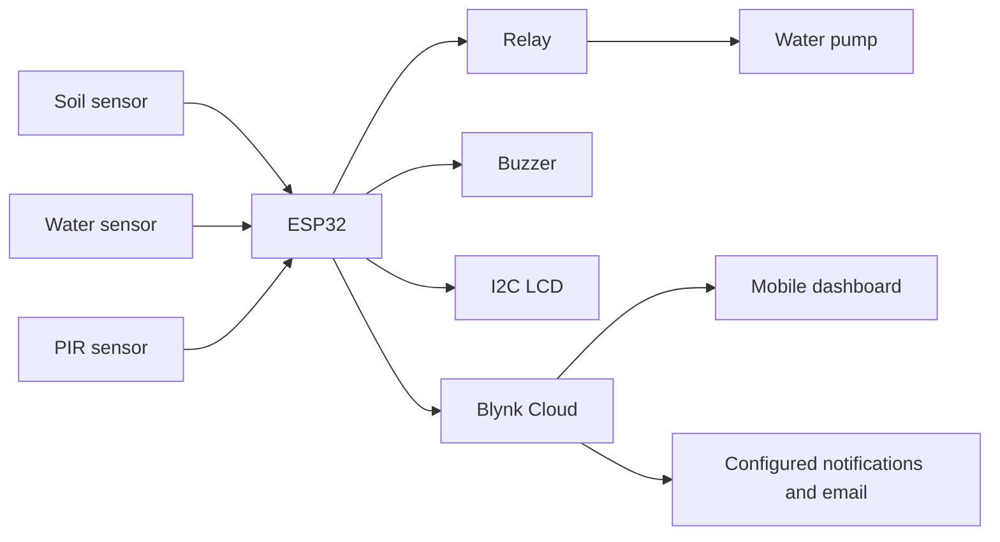
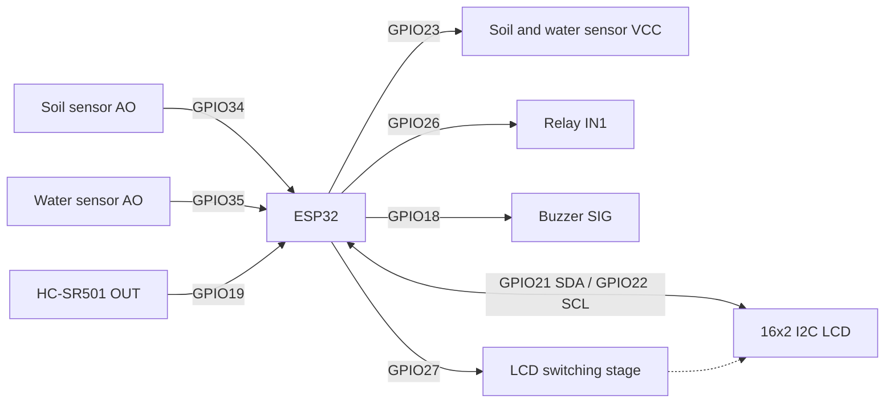
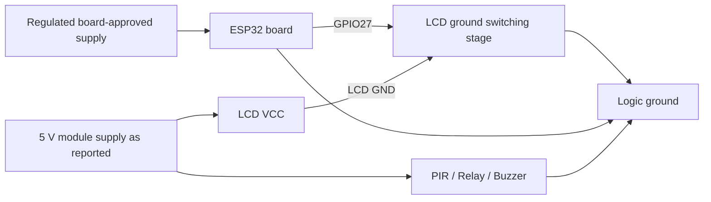
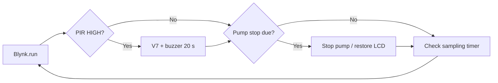
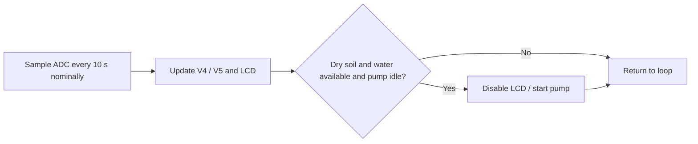

# Smart Garden — IoT-Based Plant Monitoring & Irrigation


An ESP32-based smart gardening prototype that combines environmental sensing, automated irrigation, local LCD feedback, and remote monitoring through Blynk IoT. Developed as a group project for ITE233 — Introduction to Internet of Things at Stamford International University (October 2025).

## Features

- Soil moisture and reservoir water-level monitoring using analog sensors.
- Automatic relay-controlled irrigation based on calibrated ADC thresholds.
- Low-water protection and a Blynk event when an active watering cycle stops because the tank is empty.
- PIR motion detection with a 1 kHz buzzer alarm and Blynk status message.
- 16×2 I²C LCD with power switching during pump operation and reinitialization afterward.
- Wi-Fi telemetry, serial diagnostics, and Blynk dashboard integration.

## System architecture



## Hardware

| Component | Quantity |
|---|---:|
| ESP-WROOM-32 development board | 1 |
| Soil moisture sensor | 1 |
| Analog water-level sensor | 1 |
| HC-SR501 PIR sensor | 1 |
| Single-channel relay module | 1 |
| Brushless mini water pump | 1 |
| Low-trigger passive buzzer module | 1 |
| PCF8574T 16×2 I²C LCD | 1 |
| LCD switching transistor/stage | 1 |
| Breadboard, jumper wires and appropriate power supplies | As required |

The report estimates the prototype cost at approximately THB 600–700 in 2025.

## ESP32 connection diagrams



The connection diagram reconstructs the signal assignments from the report's physical design table (page 10) and the supplied V1 firmware. It is a logical connection drawing, not a verified physical header layout or a simulated circuit.

| ESP32 GPIO | Component terminal | Function |
|---|---|---|
| 34 | Soil sensor AO | ADC input |
| 35 | Water sensor AO | ADC input |
| 23 | Soil and water sensor VCC (as reported) | Switched sensor supply |
| 19 | HC-SR501 OUT | Digital motion input |
| 26 | Relay IN1 | Active LOW pump control |
| 18 | Buzzer SIG | 1 kHz tone; idle HIGH |
| 21 | LCD SDA | I²C data |
| 22 | LCD SCL | I²C clock |
| 27 | LCD switching stage control | HIGH enables LCD; LOW disables LCD |

### Power and relay wiring




The report specifies 5 V for the PIR, relay module, buzzer and LCD, common ground for the logic modules, and pump positive through the relay's normally open (NO) contact. Pump supply positive connects to COM; pump negative returns to its supply negative. GPIO27 controls an LCD ground-switching transistor in the firmware, although its exact type, resistor values and circuit are not specified in the report.

**Important electrical precautions:** These diagrams document the project and are not a validated build schematic. Verify the actual development board, sensor modules and pump voltage/current ratings before wiring. The report mentions both a 5 V/2 A adapter and a 9 V battery; do not apply 9 V directly to an unverified ESP32 VIN/5V input. Use regulated board-approved power and a correctly rated pump supply. Keep ESP32 signal voltages within 3.3 V logic limits. Verify relay and buzzer input compatibility; use an interface driver if required. GPIO23 must not supply more current than permitted; a 3.3 V load switch is preferable for powering both sensors. A 5 V LCD backpack may pull I²C lines to 5 V; use a suitable bidirectional level shifter. Validate LCD switching and prevent back-powering through SDA/SCL. Include appropriate transient protection and decoupling for the pump and relay. See [Espressif hardware guidelines](https://docs.espressif.com/projects/esp-hardware-design-guidelines/en/latest/esp32/schematic-checklist.html) and [ESP32-WROOM-32 datasheet](https://documentation.espressif.com/esp32-wroom-32_datasheet_en.html).

## Firmware behavior

| Parameter | V1 setting |
|---|---|
| Dry soil | ADC reading ≥ 2550 |
| Low water | ADC reading ≤ 600 |
| Nominal sensor sampling interval | 10 seconds |
| Sensor power stabilization | 200 ms |
| Target watering duration | 30 seconds |
| Motion alarm duration | 20 seconds |
| Buzzer frequency | 1 kHz |
| LCD address / size | `0x27` / 16×2 |
| I²C frequency | 100 kHz |
| Serial baud rate | 115200 |

Raw ADC thresholds are prototype calibration values, not moisture percentages. Recalibrate for the actual sensors and soil.





Pump stop is due when the pump is active and either 30 seconds have elapsed or the cached water reading is at most 600. On stopping, the firmware logs `no_water` if the cached water is low.

### Key functions

| Function | Responsibility |
|---|---|
| `setup()` | Connect to Blynk, initialize pins, LCD and first sensor readings |
| `loop()` | Service Blynk, check motion, pump timing and periodic sampling |
| `readSensors()` | Enable sensor supply, read ADC, publish telemetry, evaluate watering start |
| `startPump()` | Disable LCD, energize active-low relay, record start time |
| `stopPump()` | Disable relay, restore LCD, publish motor state and conditional low-water event |
| `lcdReady()` / `lcdReinit()` | Probe I²C address and reinitialize display |
| `showOnLCD()` | Display cached soil and water readings when LCD is powered |
| `toneBuzzer()` | Generate 1 kHz tone with a blocking delay |

## Blynk configuration

Create a device template and a device in Blynk. Configure these virtual datastreams to match the sketch:

| Virtual pin | Meaning | Suggested type |
|---|---|---|
| V4 | Soil ADC reading | Integer (0–4095) |
| V5 | Water ADC reading | Integer (0–4095) |
| V6 | Pump state | Integer (0 or 1) |
| V7 | Motion alert text | String |

Create the event code `no_water` and configure notification/email delivery in Blynk as appropriate. The firmware calls `Blynk.logEvent()` for this event when stopping a pump cycle with low water. V7 is a text update, not a motion event or a guaranteed push notification. No remote manual pump control handler is implemented.

## Installation

1. Install Arduino IDE and the Espressif ESP32 board package.
2. Install the Blynk and LiquidCrystal_I2C libraries. WiFi, WiFiClient and Wire are provided by the ESP32 Arduino core.
3. Open `Smart_Garden_V1/Smart_Garden_V1.ino` and select your actual ESP32 board and serial port.
4. Replace the placeholder template ID, device token, Wi-Fi SSID and password with your own local values. Do not commit working credentials.
5. Set up Blynk datastreams and the `no_water` event as described above.
6. Verify the electrical design and connections before connecting power. Upload the sketch and open Serial Monitor at 115200 baud.
7. Test the sensor readings and relay behavior with the pump disconnected first, then perform supervised watering tests.

## Project structure

```text
SmartGarden/
├── README.md
└── Smart_Garden_V1/
    └── Smart_Garden_V1.ino
```

All diagrams are embedded as GitHub-native Mermaid blocks; no external image files are needed. Before publishing the sketch or report, remove credentials and personal identifiers. Rotate any exposed credentials.

## Prototype results and engineering challenges

The project report documents successful prototype watering, LCD readings, and Blynk telemetry. Its dashboard screenshots show soil and water gauges, and its email screenshot shows the `no_water` event. The team reported debugging ESP32 resets during pump operation, correcting the LCD I²C address, calibrating unstable analog readings, and troubleshooting Blynk connectivity. These are reported prototype outcomes, not independent verification or new hardware tests performed for this README.

## Current limitations and next steps

- The 20-second motion alarm uses blocking `delay()`, which can postpone Blynk servicing, ADC sampling and pump shutdown. The 30-second duration is therefore a target, not a guaranteed maximum. Replace blocking delays with a non-blocking state machine.
- Low-water detection uses cached readings and only logs `no_water` in `stopPump()`. An already-empty idle reservoir does not trigger that event in V1. Add independent monitoring and alert rate limiting.
- Soil becoming moist does not stop an active cycle in the supplied sketch; only time or cached low water does. Add hysteresis and a cooldown to prevent repeated watering.
- Hardware outputs are initialized after `Blynk.begin()`. Initialize safe actuator states before network connection and add offline operation/reconnect handling.
- The sketch uses `BlynkSimpleEsp32.h`, not the SSL variant mentioned in the report's library table. Review encrypted connectivity for deployment.
- Improve pump power isolation, LCD switching, sensor calibration, and watchdog/fail-safe protection before unattended use.
- Future extensions: temperature/humidity sensors, solar power, fertilizer control, and an additional dashboard.

## Contributors

- Lin Thant Kyaw
- Hein Thant Kyaw
- Zin Lin Htet

Stamford International University — ITE233, Term 1, 2025.
