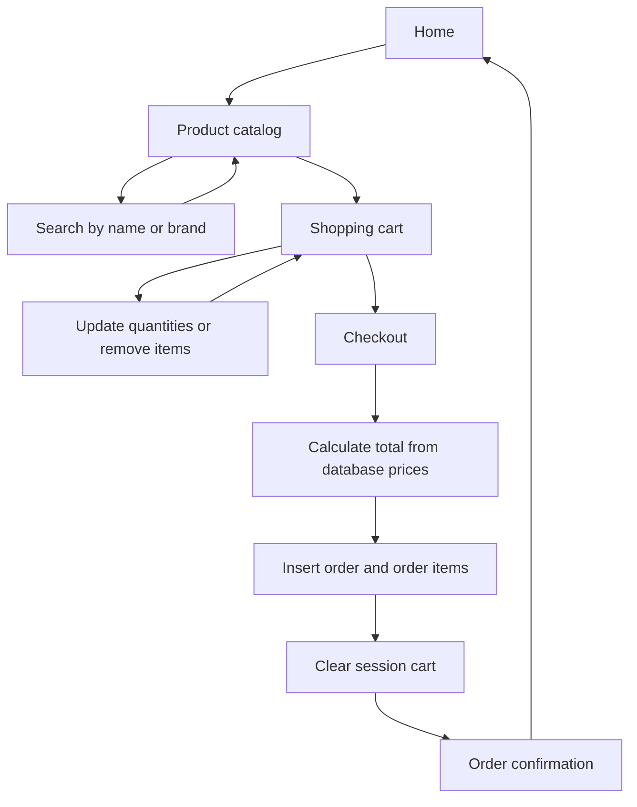
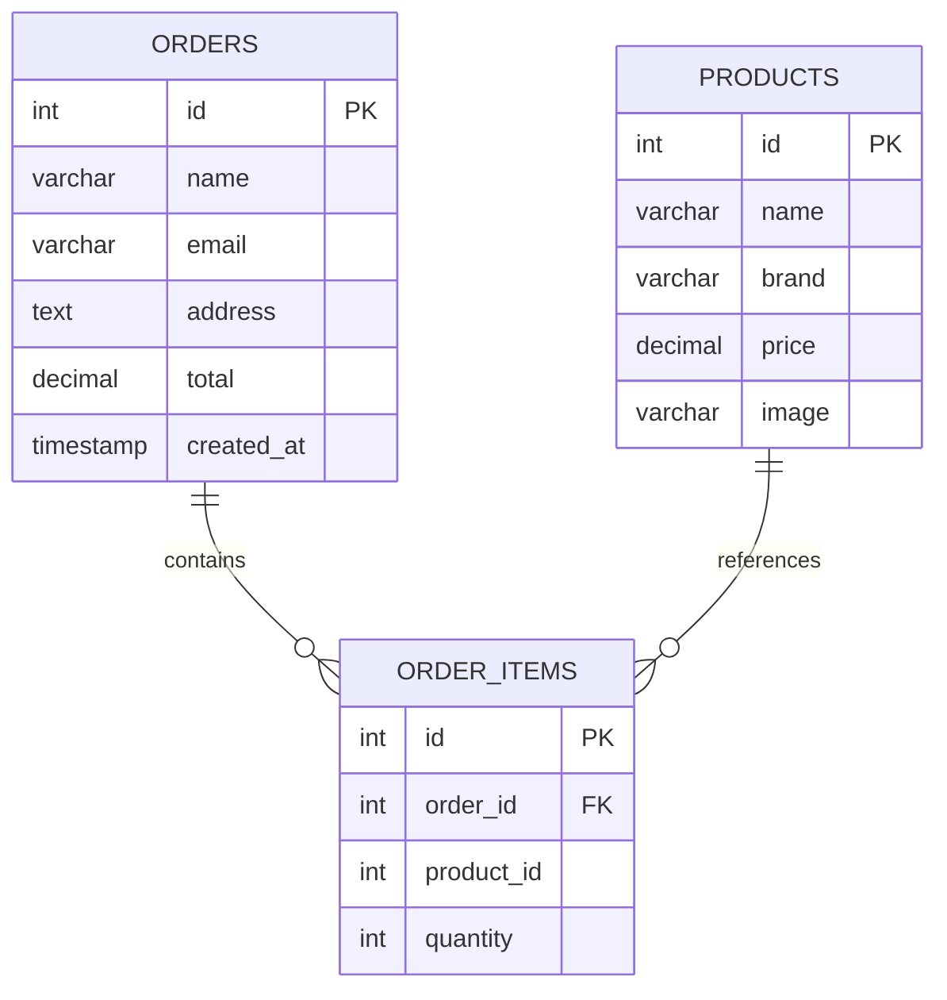

# ChronoLuxe — Watch E-Commerce Web Application


> Timeless Luxury. Modern Precision.

## Overview

ChronoLuxe is a full-stack e-commerce prototype for a luxury watch storefront, built using PHP, MySQL, Bootstrap and custom CSS. It demonstrates a database-driven shopping workflow, from product discovery and session-based cart management to checkout and persistent order creation.

The project focuses on integrating frontend interfaces with server-side business logic, maintaining shopping cart state across HTTP requests, and organizing product and order data in a relational database.

## Features

- **Product catalog:** Dynamically displays watch names, brands, prices and images from MySQL, with ten sample products included in the database script.
- **Product search:** Searches by watch name or brand using SQL `LIKE` queries.
- **Shopping cart:** Adds products, increments existing quantities, updates quantities and removes items. Cart state is maintained through PHP sessions.
- **Price calculation:** Calculates item subtotals and order totals on the server using database prices.
- **Checkout:** Collects customer name, email and delivery address and displays an order summary.
- **Order persistence:** Saves order information and associated product quantities to separate relational tables.
- **Order confirmation:** Clears the session cart after order creation and displays the order ID, customer name and total.
- **User interface:** Dark luxury-inspired theme, mint-green accents, Bootstrap grid layouts, reusable navigation and hover transitions.
- **Informational pages:** About page and a contact form interface.

## Technology Stack

| Layer | Technology |
| --- | --- |
| Frontend | HTML5, CSS3, Bootstrap 5.3.3 |
| Backend | PHP |
| Database | MySQL |
| Database access | MySQLi |
| State management | PHP sessions |
| Local development | XAMPP or PHP development server |

## Application Workflow



## Project Structure

```text
ChronoLuxe/
├── index.php       # Entry point; redirects to home.php
├── home.php        # Storefront landing page
├── category.php    # Product catalog and search
├── cart.php        # Cart operations and price calculation
├── checkout.php    # Customer details and order creation
├── success.php     # Order confirmation
├── about.php       # Store information
├── contact.php     # Contact form interface
├── shared.php      # Database connection and session initialization
├── navbar.php      # Shared navigation and cart quantity indicator
├── style.css       # Custom theme and component styling
├── db.sql          # Database schema and sample product data
├── images/        # Expected product image directory
└── README.md
```

The supplied entry-point file is named `index(1).php`; rename it to `index.php` if necessary. The SQL script references `images/watch1.png` through `images/watch10.png`. Supply these assets separately or update the image paths in the database.

## Database Design

Database: `watch_store`

| Table | Purpose | Key fields |
| --- | --- | --- |
| `products` | Product catalog | `id`, `name`, `brand`, `price`, `image` |
| `orders` | Customer and order summary | `id`, `name`, `email`, `address`, `total`, `created_at` |
| `order_items` | Products associated with an order | `id`, `order_id`, `product_id`, `quantity` |



The database enforces the `order_id` foreign key with `ON DELETE CASCADE`. The relationship to `products` is logical only; the current schema does not enforce a foreign key on `product_id`.

## Installation and Setup

### Prerequisites

- PHP 8.x recommended, with the MySQLi extension and sessions enabled
- MySQL or compatible MariaDB server
- Apache (e.g., XAMPP) or PHP's built-in development server
- Internet access for Bootstrap CDN assets

### 1. Prepare project files

Download or clone the repository and place the project files in one directory named `ChronoLuxe`. If using XAMPP, place it inside the web root:

- Windows: `C:\xampp\htdocs\ChronoLuxe`
- macOS: `/Applications/XAMPP/xamppfiles/htdocs/ChronoLuxe`

### 2. Initialize the database

Start MySQL and import `db.sql` through phpMyAdmin, or run the following from the project directory:

```bash
mysql -u root -p < db.sql
```

For a local root account without a password, omit `-p` if appropriate.

> **Warning:** The script drops and recreates the three application tables, deleting existing product and order data. Use a development database and back up existing data before importing.

### 3. Configure the database connection

Update the connection settings in `shared.php` to match your local environment:

```php
$host = "localhost";
$user = "root";
$pass = "";
$db   = "watch_store";
```

These defaults are for local development only. Do not commit real database credentials.

### 4. Launch the application

Start Apache in XAMPP and visit:

```text
http://localhost/ChronoLuxe/
```

Alternatively, with MySQL already running, execute this command from the project directory:

```bash
php -S localhost:8000
```

Open `http://localhost:8000/home.php` in your browser.

## Technical Implementation

### Session-based cart management

The cart stores product IDs as keys and quantities as values in `$_SESSION['cart']`. Product details are retrieved from MySQL when rendering the cart rather than storing prices in the session. The shared `cart_count()` helper calculates the total number of units for the navigation bar.

### Server-side order processing

Checkout retrieves product prices from the database and computes the total based on session quantities. It inserts an order header, obtains the generated order ID, and inserts the corresponding order items. The cart is then emptied and the browser is redirected to the confirmation page.

### Input handling and reusable components

The implementation uses integer casting for product and order identifiers, `mysqli::real_escape_string()` for selected SQL inputs, and `htmlspecialchars()` for dynamic HTML output. Database initialization and navigation are centralized in shared PHP files.

These are foundational safeguards, not a complete production security model.

## Suggested Manual Test Cases

| Scenario | Expected behavior |
| --- | --- |
| Search for a sample brand | Matching products appear |
| Add the same product twice | Quantity increases to two |
| Change quantity and update cart | Subtotal and total are recalculated |
| Set quantity to zero | Product is removed |
| Open checkout with an empty cart | Redirect to product catalog |
| Submit a valid sample order | Order and item records are created, cart is cleared and confirmation is displayed |
| Request a nonexistent order ID | Order-not-found message appears |

These are suggested verification scenarios, not a claim that an automated test suite has been executed.

## Current Limitations and Future Improvements

ChronoLuxe is a demonstration storefront, not a production-ready commerce platform. Checkout records orders without charging customers. Confirmation email delivery and contact form submission are not implemented.

Potential improvements include:

- Integrate a payment gateway and transactional email delivery.
- Introduce customer authentication and order ownership checks; currently, confirmation records can be retrieved by order ID.
- Replace interpolated SQL with prepared statements, add server-side field validation and CSRF protection, and use POST for removal actions.
- Wrap order and order-item inserts in a database transaction with rollback and error handling.
- Validate cart product IDs, add inventory management and enforce the product foreign key.
- Store purchase-time unit prices and use decimal-safe monetary calculations.
- Add an administration interface, order history and automated integration tests.
- Add mobile viewport metadata and verify layouts on smaller devices.

## Project Scope

This project demonstrates PHP web development, relational database modeling, session management, reusable UI components and the implementation of an end-to-end simulated shopping workflow. Product names and brands are sample catalog content; the application is not an official store or a claim of affiliation with those brands.
